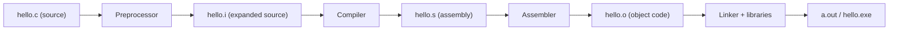
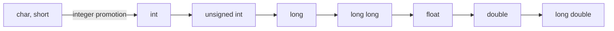
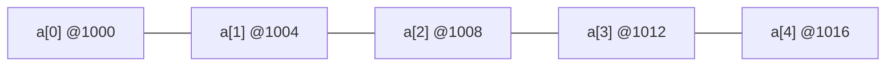
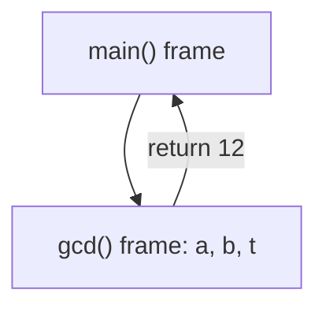
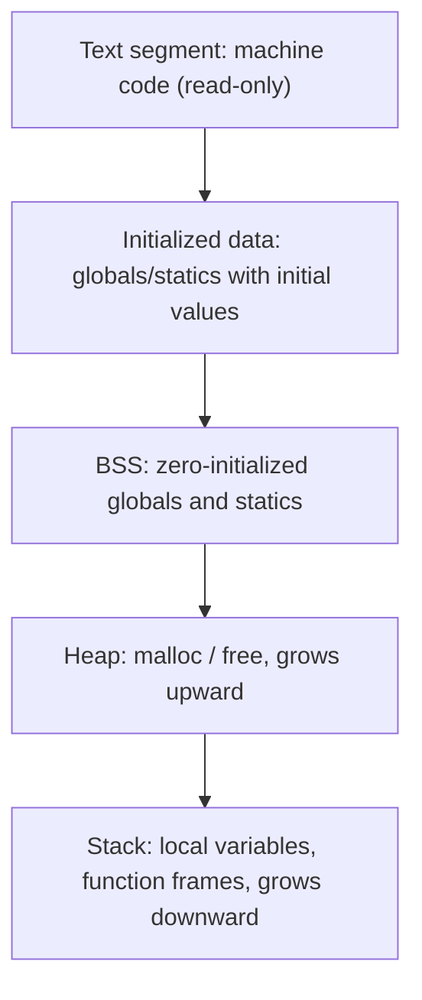
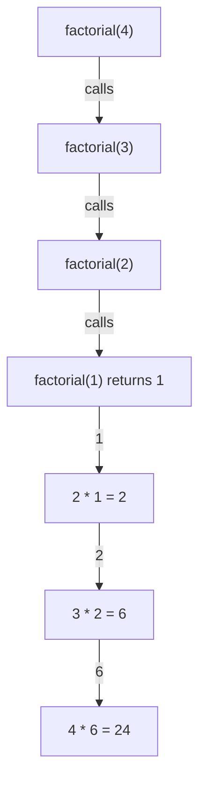
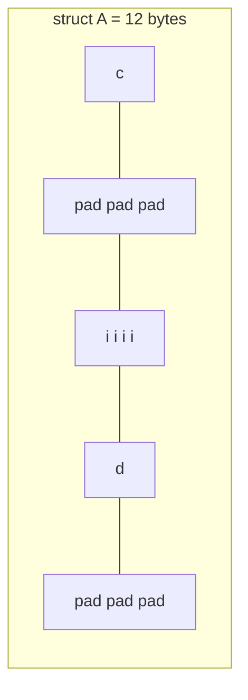
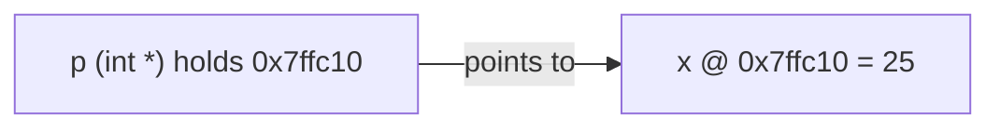
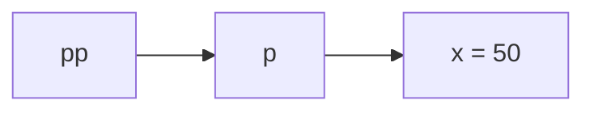
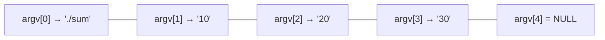

=== Introduction to C and How a C Program Is Built
difficulty: easy
---
C was created by **Dennis Ritchie at Bell Labs in 1972** to rewrite the UNIX operating system. It sits in a sweet spot between assembly and high-level languages: it is portable and readable, yet it gives you direct access to memory through pointers. That is why operating systems (Linux, Windows kernels), embedded firmware, databases and the runtimes of Python and Java are still written in C.

### Why C is called a "middle-level" language
- **High-level features:** functions, loops, structured types, a portable standard library.
- **Low-level features:** pointers, manual memory management, bit manipulation, the ability to place data at specific addresses.

### Key features interviewers ask about
1. **Procedural** — a program is a set of functions; there are no classes.
2. **Compiled** — source code becomes native machine code ahead of time, so C programs are fast.
3. **Portable** — the same source compiles on many CPUs because the standard (C89/C90, C99, C11, C17) defines the language, not the hardware.
4. **Small core, rich library** — only 32 keywords in C89 (`int`, `for`, `return`, `struct`, ...), with I/O, strings and math in the standard library.
5. **No runtime safety nets** — no bounds checking, no garbage collector, no exceptions. Speed is bought with responsibility.

### From source code to executable
A C program goes through four stages. Interviewers love "what happens when you run `gcc hello.c`?"



| Stage | What it does | gcc flag to stop here |
|---|---|---|
| Preprocessing | Expands `#include`, replaces macros, strips comments, handles `#if` | `gcc -E` |
| Compilation | Checks syntax and types, turns C into assembly | `gcc -S` |
| Assembly | Turns assembly into machine code (an object file) | `gcc -c` |
| Linking | Joins object files and library code (e.g. `printf`) into one executable | (default) |

```text
$ gcc hello.c -o hello      # all four stages
$ ./hello                   # the OS loader runs the executable
```

### Compiler vs interpreter
A **compiler** translates the whole program once, before it runs, and reports all syntax errors up front. An **interpreter** (Python, classic BASIC) translates and executes one statement at a time while the program runs. Compiled code runs faster; interpreted code is easier to try out interactively.

### Syntax errors vs logic errors
- **Compile-time (syntax/semantic) errors:** a missing semicolon, an undeclared variable. The compiler refuses to build.
- **Link-time errors:** "undefined reference to `foo`" — you declared a function but never defined it, or forgot a library.
- **Run-time errors:** dividing by zero, dereferencing NULL (segmentation fault).
- **Logic errors:** the program runs but prints the wrong answer. Only testing and debugging find these.

**Key points:**
- C = procedural, compiled, portable, close to the hardware.
- Build pipeline: preprocess → compile → assemble → link.
- `-E`, `-S`, `-c` stop gcc after each stage — a favourite viva question.

=== Structure of a C Program, printf and Comments
difficulty: easy
---
Every C program has the same skeleton: preprocessor directives, optional global declarations, and a function named **`main`** where execution begins.

```c
#include <stdio.h>          // 1. preprocessor directive: declarations of printf etc.

int square(int x);          // 2. function prototype (declaration)

int main(void)              // 3. execution starts here
{
    int n = 7;              // 4. local variable
    printf("Hello, C!\n");
    printf("%d squared is %d\n", n, square(n));
    return 0;               // 5. 0 tells the OS "success"
}

int square(int x)           // 6. function definition
{
    return x * x;
}
```

```text
Hello, C!
7 squared is 49
```

**Line by line:**
- `#include <stdio.h>` asks the preprocessor to paste in the standard I/O header, which **declares** `printf`. The function's code itself lives in the C library and is joined in by the linker.
- `int main(void)` — `main` returns an `int` to the operating system. `void` in the parentheses means "takes no arguments". `int main(int argc, char *argv[])` is the other standard form.
- `printf` takes a **format string** plus values. `%d` is replaced by the next `int` argument; `\n` is the newline escape sequence.
- `return 0;` signals success. In C99 and later, falling off the end of `main` also returns 0 — but only `main` gets this treatment.

### Displaying values with printf
The most-used format specifiers:

| Specifier | Type | Example output |
|---|---|---|
| `%d` / `%i` | `int` | `42` |
| `%u` | `unsigned int` | `42` |
| `%ld`, `%lld` | `long`, `long long` | `9000000000` |
| `%f` | `double` (and `float`, promoted) | `3.140000` |
| `%.2f` | `double`, 2 decimals | `3.14` |
| `%e` | scientific notation | `3.140000e+00` |
| `%c` | `char` | `A` |
| `%s` | string (`char *`) | `hello` |
| `%x`, `%o` | hexadecimal, octal | `ff`, `377` |
| `%p` | pointer (address) | `0061FF1C` |
| `%%` | a literal `%` | `%` |

```c
#include <stdio.h>

int main(void)
{
    int age = 21;
    double cgpa = 8.756;
    char grade = 'A';

    printf("Age: %d, CGPA: %.2f, Grade: %c\n", age, cgpa, grade);
    printf("[%5d] [%-5d] [%05d]\n", age, age, age);   // width, left-align, zero-pad
    printf("255 in hex = %x, in octal = %o\n", 255, 255);
    printf("Progress: 100%%\n");
    return 0;
}
```

```text
Age: 21, CGPA: 8.76, Grade: A
[   21] [21   ] [00021]
255 in hex = ff, in octal = 377
Progress: 100%
```

### Comments
- `/* ... */` — block comment, can span lines, **cannot be nested**.
- `// ...` — line comment, added in C99.

A classic trick question: `/* outer /* inner */ still a comment? */` — no. The first `*/` ends the comment, so `still a comment? */` becomes code and fails to compile.

**Key points:**
- Execution always starts at `main`, whatever order functions appear in.
- A header file gives **declarations**; the library gives **definitions**.
- Mismatching a specifier and its argument (`printf("%d", 3.5)`) is undefined behaviour — the compiler may only warn.

=== Data Types, Constants and the sizeof Operator
difficulty: easy
---
C has a small set of **basic types**; everything else (arrays, structures, pointers) is built from them.

| Type | Typical size (64-bit Linux/Windows) | Range / notes |
|---|---|---|
| `char` | 1 byte | -128 to 127 (or 0 to 255 if unsigned by default) |
| `short` | 2 bytes | -32,768 to 32,767 |
| `int` | 4 bytes | about ±2.1 billion |
| `long` | 8 bytes on Linux, 4 on Windows | at least 4 bytes |
| `long long` | 8 bytes | about ±9.2 × 10^18 |
| `float` | 4 bytes | ~6-7 significant digits |
| `double` | 8 bytes | ~15-16 significant digits |
| `long double` | 8, 12 or 16 bytes | platform dependent |
| `_Bool` (`bool` via `<stdbool.h>`) | 1 byte | 0 or 1 |

The C standard fixes only **minimum** sizes and the ordering `sizeof(char) == 1 <= short <= int <= long <= long long`. That is why "what is the size of `int`?" has the honest answer "it depends on the compiler and platform — usually 4 bytes today".

### Type modifiers
- `signed` / `unsigned` — whether negative values are allowed. `unsigned int` trades the sign for double the positive range.
- `short` / `long` — shrink or grow the integer.

### sizeof
`sizeof` is a **compile-time operator**, not a function. It gives the size in bytes of a type or an expression, as a `size_t` (print it with `%zu`).

```c
#include <stdio.h>

int main(void)
{
    printf("char   : %d\n", (int)sizeof(char));
    printf("short  : %d\n", (int)sizeof(short));
    printf("int    : %d\n", (int)sizeof(int));
    printf("float  : %d\n", (int)sizeof(float));
    printf("double : %d\n", (int)sizeof(double));

    int a[10];
    printf("array of 10 ints : %d bytes\n", (int)sizeof(a));
    printf("elements in a    : %d\n", (int)(sizeof(a) / sizeof(a[0])));

    int x = 5;
    int s = sizeof(x++);          // operand is NOT evaluated
    printf("s = %d, x = %d\n", s, x);
    return 0;
}
```

```text
char   : 1
short  : 2
int    : 4
float  : 4
double : 8
array of 10 ints : 40 bytes
elements in a    : 10
s = 4, x = 5
```

The last line is a favourite trick: `sizeof` only looks at the **type** of its operand, so `x++` never runs and `x` stays 5.

### Constants (literals)
| Kind | Examples |
|---|---|
| Integer | `42`, `-7`, `0x2A` (hex), `052` (octal), `42U`, `42L`, `42LL` |
| Floating | `3.14`, `2.5e-3`, `1.5f` (a `float`; without `f` it is a `double`) |
| Character | `'A'`, `'\n'`, `'\0'`, `'\x41'` |
| String | `"hello"` — a `char` array ending in `'\0'` |

Watch out for leading zeros: `int n = 010;` stores **8**, because `010` is octal.

### Integer overflow
```c
#include <stdio.h>
#include <limits.h>

int main(void)
{
    unsigned int u = 0;
    u = u - 1;                         // unsigned arithmetic wraps around
    printf("UINT_MAX     = %u\n", UINT_MAX);
    printf("0u - 1       = %u\n", u);
    printf("INT_MAX      = %d\n", INT_MAX);
    printf("INT_MIN      = %d\n", INT_MIN);
    return 0;
}
```

```text
UINT_MAX     = 4294967295
0u - 1       = 4294967295
INT_MAX      = 2147483647
INT_MIN      = -2147483648
```

**Unsigned** overflow is well defined: it wraps modulo 2^n. **Signed** overflow (`INT_MAX + 1`) is **undefined behaviour** — the compiler is allowed to assume it never happens.

**Key points:**
- Only minimum sizes are guaranteed; use `sizeof` instead of assuming.
- `sizeof(array) / sizeof(array[0])` gives the element count — but only where the array has not decayed to a pointer.
- `1.5` is a `double`, `1.5f` is a `float`; `'A'` is a character, `"A"` is a 2-byte string.

=== Variables, Arithmetic Expressions and Type Conversion
difficulty: easy
---
A **variable** is a named piece of storage with a type. In C you must declare it before you use it, and an uninitialized local variable contains garbage.

```c
int count;          // declaration (and definition) — value is garbage if local
int total = 0;      // declaration with initialization
const int MAX = 100; // read-only after initialization
```

**Naming rules:** letters, digits and `_`; cannot start with a digit; case-sensitive (`sum` and `Sum` differ); cannot be a keyword.

### Arithmetic operators and integer division
`+ - * / %` work as expected, with two traps:
1. **Integer division truncates toward zero:** `7 / 2` is `3`, `-7 / 2` is `-3`.
2. **`%` only works on integers**, and the result takes the sign of the left operand: `-7 % 3` is `-1`.

```c
#include <stdio.h>

int main(void)
{
    int a = 7, b = 2;
    printf("7 / 2      = %d\n", a / b);
    printf("7 %% 2      = %d\n", a % b);
    printf("-7 / 2     = %d\n", -a / b);
    printf("-7 %% 3     = %d\n", -7 % 3);
    printf("7 / 2.0    = %.1f\n", a / 2.0);       // one double operand -> double division
    printf("(double)7/2= %.1f\n", (double)a / b); // cast first, then divide
    printf("(double)(7/2) = %.1f\n", (double)(a / b)); // too late: already 3
    return 0;
}
```

```text
7 / 2      = 3
7 % 2      = 1
-7 / 2     = -3
-7 % 3     = -1
7 / 2.0    = 3.5
(double)7/2= 3.5
(double)(7/2) = 3.0
```

### Implicit conversions (the "usual arithmetic conversions")
When an operator mixes types, C converts the "smaller" operand to the "larger" type before computing:



- `char` and `short` are always promoted to `int` in expressions.
- Assigning a `double` to an `int` **truncates** the fraction: `int n = 9.99;` stores 9.

### The signed/unsigned trap
```c
#include <stdio.h>

int main(void)
{
    int i = -1;
    unsigned int u = 1;
    if (i < u)
        printf("-1 < 1u\n");
    else
        printf("-1 > 1u  (surprise!)\n");
    return 0;
}
```

```text
-1 > 1u  (surprise!)
```

Because `i` is converted to `unsigned int`, `-1` becomes 4,294,967,295. Many "why does my loop never end?" bugs come from comparing a signed index with an unsigned size.

### Compound assignment operators
`a += 5` means `a = a + 5`. The same pattern exists for `-= *= /= %= &= |= ^= <<= >>=`. The left side is evaluated only once, which matters for expressions such as `arr[i++] += 2`.

**Key points:**
- Integer `/` truncates; cast **before** dividing to get a fractional result.
- Mixed-type expressions convert to the wider type; signed + unsigned converts to unsigned.
- Local variables are not zero-initialized — always initialize them.

=== Operators: Increment, Logical, Precedence and Side Effects
difficulty: medium
---
### Increment and decrement
- `++x` (**pre**-increment): increment first, then use the new value.
- `x++` (**post**-increment): use the current value, then increment.

```c
#include <stdio.h>

int main(void)
{
    int x = 5, y;
    y = x++;               // y gets 5, then x becomes 6
    printf("x=%d y=%d\n", x, y);
    y = ++x;               // x becomes 7, then y gets 7
    printf("x=%d y=%d\n", x, y);
    return 0;
}
```

```text
x=6 y=5
x=7 y=7
```

### Relational and logical operators
- Relational: `< <= > >= == !=` — each yields `int` 1 (true) or 0 (false).
- Logical: `&&` (AND), `||` (OR), `!` (NOT). Any non-zero value counts as true.

**Short-circuit evaluation:** `&&` stops as soon as the left side is false; `||` stops as soon as the left side is true. The right side may never run:

```c
#include <stdio.h>

int main(void)
{
    int a = 0, b = 0;
    if (a != 0 && ++b > 0) { }     // ++b skipped: a != 0 is false
    printf("b = %d\n", b);
    if (a == 0 || ++b > 0) { }     // ++b skipped: a == 0 is true
    printf("b = %d\n", b);

    int *p = NULL;
    if (p != NULL && *p == 10)     // safe: *p never evaluated when p is NULL
        printf("ten\n");
    printf("no crash\n");
    return 0;
}
```

```text
b = 0
b = 0
no crash
```

### Precedence and associativity (highest to lowest, simplified)
| Level | Operators | Associativity |
|---|---|---|
| 1 | `()` `[]` `->` `.` postfix `++ --` | left to right |
| 2 | unary `! ~ ++ -- + - * & sizeof (type)` | right to left |
| 3 | `* / %` | left to right |
| 4 | `+ -` | left to right |
| 5 | `<< >>` | left to right |
| 6 | `< <= > >=` | left to right |
| 7 | `== !=` | left to right |
| 8 | `&` | left to right |
| 9 | `^` | left to right |
| 10 | `\|` | left to right |
| 11 | `&&` | left to right |
| 12 | `\|\|` | left to right |
| 13 | `?:` | right to left |
| 14 | `= += -=` etc. | right to left |
| 15 | `,` | left to right |

Two famous gotchas follow from this table:
- `if (x & 1 == 0)` parses as `x & (1 == 0)`, i.e. `x & 0` — always false. Write `if ((x & 1) == 0)`.
- `*p++` parses as `*(p++)`: it moves the pointer, not the value.

### Undefined behaviour: modifying a variable twice
```c
int i = 5;
i = i++ + ++i;     // undefined behaviour
printf("%d %d\n", i++, i++);   // undefined behaviour
```
C does not say in which order the operands of `+` or the arguments of a function are evaluated, and modifying the same variable twice without a **sequence point** in between is undefined. Different compilers print different numbers. The right interview answer is "undefined behaviour — the program is wrong", not a number.

Sequence points include the end of a full expression (`;`), `&&`, `||`, `?:`, the comma operator, and the moment just before a function is called.

### The comma and conditional operators
```c
int a = (1, 2, 3);           // comma operator: evaluates all, yields the last -> 3
int max = (x > y) ? x : y;   // conditional (ternary) operator
```

**Key points:**
- Pre-increment changes then uses; post-increment uses then changes.
- `&&` and `||` short-circuit — use it to guard pointer dereferences.
- When precedence is not obvious, add parentheses.
- `i = i++ + ++i` is undefined behaviour, not a puzzle with one answer.

=== Decision Making: if, switch and the Conditional Operator
difficulty: easy
---
### if, else if, else
```c
#include <stdio.h>

int main(void)
{
    int marks = 72;
    if (marks >= 90)
        printf("Grade A\n");
    else if (marks >= 75)
        printf("Grade B\n");
    else if (marks >= 60)
        printf("Grade C\n");
    else
        printf("Fail\n");
    return 0;
}
```

```text
Grade C
```

**Dangling else:** an `else` always pairs with the nearest unmatched `if`, regardless of indentation. Use braces whenever you nest.

```c
if (a > 0)
    if (b > 0)
        printf("both positive\n");
else                         // belongs to "if (b > 0)", NOT to "if (a > 0)"
    printf("a not positive?\n");
```

**The `=` vs `==` bug:** `if (x = 5)` assigns 5 and is always true. Some programmers write `if (5 == x)` ("Yoda condition") so a typo becomes a compile error.

### switch
`switch` compares an **integer expression** (including `char` and `enum`) against constant `case` labels.

```c
#include <stdio.h>

int main(void)
{
    char op = '*';
    int a = 6, b = 3;
    switch (op) {
    case '+': printf("%d\n", a + b); break;
    case '-': printf("%d\n", a - b); break;
    case '*': printf("%d\n", a * b); break;
    case '/': printf("%d\n", a / b); break;
    default:  printf("unknown operator\n");
    }

    int day = 6;
    switch (day) {           // fall-through on purpose: several labels, one action
    case 6:
    case 7:
        printf("weekend\n");
        break;
    default:
        printf("weekday\n");
    }
    return 0;
}
```

```text
18
weekend
```

Interview facts about `switch`:
- Case labels must be **compile-time integer constants** — no ranges, no strings, no `float`.
- Without `break`, execution **falls through** into the next case.
- `default` is optional and may appear anywhere.
- Duplicate case values are a compile error.

### Boolean values in C
C89 has no boolean type: 0 is false and any non-zero value is true. C99 added `_Bool`, and `<stdbool.h>` defines `bool`, `true` (1) and `false` (0).

```c
#include <stdbool.h>
bool isEven(int n) { return n % 2 == 0; }
```

### The conditional operator
`condition ? expr1 : expr2` is an expression, so it can be used where `if` cannot — in an initializer, a `printf` argument or a macro:

```c
printf("%d is %s\n", n, n % 2 == 0 ? "even" : "odd");
int abs_n = n < 0 ? -n : n;
```

**Key points:**
- `else` binds to the nearest `if` — brace your nested ifs.
- `switch` works only on integer types with constant labels; remember `break`.
- `?:` is the only ternary operator in C and it returns a value.

=== Loops: for, while, do-while, break and continue
difficulty: easy
---
C has three loops. All three can do the same job; choose the one that reads best.

| Loop | Checks condition | Runs at least once? | Typical use |
|---|---|---|---|
| `for` | before each iteration | no | known number of iterations |
| `while` | before each iteration | no | unknown count, e.g. reading input |
| `do-while` | after each iteration | **yes** | menus, "ask until valid" |

```c
#include <stdio.h>

int main(void)
{
    // for: the 10th triangular number (1 + 2 + ... + 10)
    int sum = 0;
    for (int i = 1; i <= 10; i++)
        sum += i;
    printf("triangular(10) = %d\n", sum);

    // while: reverse the digits of a number
    int n = 1234, rev = 0;
    while (n > 0) {
        rev = rev * 10 + n % 10;
        n /= 10;
    }
    printf("reversed = %d\n", rev);

    // do-while: body runs once even though the condition is false
    int k = 100;
    do {
        printf("do-while ran with k = %d\n", k);
    } while (k < 10);
    return 0;
}
```

```text
triangular(10) = 55
reversed = 4321
do-while ran with k = 100
```

### break and continue
- `break` leaves the innermost loop (or `switch`) immediately.
- `continue` skips the rest of the current iteration and jumps to the next one (in a `for` loop, the increment still runs).

```c
#include <stdio.h>

int main(void)
{
    for (int i = 1; i <= 10; i++) {
        if (i % 2 == 0) continue;   // skip even numbers
        if (i > 7) break;           // stop after 7
        printf("%d ", i);
    }
    printf("\n");
    return 0;
}
```

```text
1 3 5 7 
```

### Nested loops: a classic pattern question
```c
#include <stdio.h>

int main(void)
{
    int rows = 4;
    for (int i = 1; i <= rows; i++) {
        for (int s = 0; s < rows - i; s++) printf(" ");
        for (int j = 1; j <= 2 * i - 1; j++) printf("*");
        printf("\n");
    }
    return 0;
}
```

```text
   *
  ***
 *****
*******
```

### Loop pitfalls
- `for (i = 0; i < 10; i++);` — the stray semicolon makes an **empty** loop body; the block below runs once.
- `while (x = 5)` — assignment, not comparison: an infinite loop.
- Infinite loops written on purpose: `for (;;)` or `while (1)`, exited with `break`.
- Comparing floats for equality in a loop condition (`for (f = 0; f != 1.0; f += 0.1)`) may never terminate because 0.1 is not exact in binary.

**Key points:**
- `do-while` always executes its body at least once.
- `continue` in a `for` loop still runs the increment expression.
- Each part of a `for` header is optional: `for (;;)` is an infinite loop.

=== Arrays: One-Dimensional, Multidimensional and Variable Length
difficulty: medium
---
An **array** is a fixed number of elements of the same type stored in **contiguous memory**. Indexing starts at 0, so an array of size `n` has valid indices `0` to `n - 1`.

```c
int marks[5];                         // 5 ints, garbage if local
int primes[5] = {2, 3, 5, 7, 11};
int partial[5] = {1, 2};              // rest become 0 -> {1, 2, 0, 0, 0}
int zeros[100] = {0};                 // all 0
int auto_size[] = {4, 8, 15, 16};     // size deduced: 4
int sparse[10] = {[2] = 5, [7] = 9};  // C99 designated initializers
```

### C does not check bounds
```c
int a[5];
a[5] = 10;      // writes past the end: undefined behaviour, no error at compile time
```
This is called a **buffer overflow**. It may corrupt another variable, crash, or appear to work — and it is the root cause of many security exploits.

### Memory layout and address calculation
For `int a[5]` starting at address 1000 with 4-byte ints, `a[i]` lives at `1000 + i * 4`. That is why indexing is O(1).



### Example: frequency count and finding the maximum
```c
#include <stdio.h>

int main(void)
{
    int ratings[] = {3, 5, 2, 5, 4, 3, 5, 1};
    int n = sizeof(ratings) / sizeof(ratings[0]);
    int freq[6] = {0};            // indices 1..5 used

    int max = ratings[0];
    for (int i = 0; i < n; i++) {
        freq[ratings[i]]++;
        if (ratings[i] > max) max = ratings[i];
    }
    for (int r = 1; r <= 5; r++)
        printf("rating %d: %d\n", r, freq[r]);
    printf("max = %d\n", max);
    return 0;
}
```

```text
rating 1: 1
rating 2: 1
rating 3: 2
rating 4: 1
rating 5: 3
max = 5
```

### Multidimensional arrays
A 2-D array is an "array of arrays", stored in **row-major order** (row 0 first, then row 1, ...).

```c
#include <stdio.h>

int main(void)
{
    int a[2][3] = { {1, 2, 3}, {4, 5, 6} };
    int b[3][2] = { {7, 8}, {9, 10}, {11, 12} };
    int c[2][2] = {0};

    for (int i = 0; i < 2; i++)
        for (int j = 0; j < 2; j++)
            for (int k = 0; k < 3; k++)
                c[i][j] += a[i][k] * b[k][j];

    for (int i = 0; i < 2; i++)
        printf("%d %d\n", c[i][0], c[i][1]);
    return 0;
}
```

```text
58 64
139 154
```

The address of `a[i][j]` in an `R x C` array is `base + (i * C + j) * sizeof(element)`. This is why, when you pass a 2-D array to a function, you must give every dimension except the first: `void print(int m[][3], int rows)`.

### Variable Length Arrays (C99)
The size can be a run-time value: `int n = read(); int v[n];`. VLAs live on the stack, cannot be initialized with `= {...}`, and became an **optional** feature in C11. For large or long-lived arrays, use `malloc` instead.

### Character arrays
`char word[] = "cat";` creates a 4-element array `{'c', 'a', 't', '\0'}`. Strings get their own topic later.

**Key points:**
- Indices run from 0 to n-1, and nothing stops you from going out of range.
- Partially initialized arrays fill the rest with zeros.
- 2-D arrays are row-major; every dimension except the first is needed in a parameter.
- An array name in most expressions becomes a pointer to its first element.

=== Functions: Definitions, Prototypes and Return Values
difficulty: easy
---
A **function** is a named block of code that does one job. Functions make programs shorter (write once, call many times), easier to test, and easier to read — the "top-down" approach is to break a problem into functions before writing any of them.

```c
return_type name(parameter_list)    // function header
{
    // body
    return value;                    // omitted for void functions
}
```

### Declaration vs definition
- A **prototype** (declaration) tells the compiler the name, return type and parameter types: `int gcd(int a, int b);`
- A **definition** contains the body.

If you call a function before the compiler has seen either, C89 assumed it returned `int` ("implicit declaration"). C99 removed that rule, and modern compilers warn or fail. Put prototypes at the top of the file or in a header.

```c
#include <stdio.h>

int gcd(int a, int b);                  // prototype
double average(const int a[], int n);
void printLine(int width);

int main(void)
{
    int nums[] = {12, 18, 30};
    printLine(20);
    printf("gcd(48, 36) = %d\n", gcd(48, 36));
    printf("average     = %.2f\n", average(nums, 3));
    printLine(20);
    return 0;
}

int gcd(int a, int b)                   // Euclid's algorithm
{
    while (b != 0) {
        int t = a % b;
        a = b;
        b = t;
    }
    return a;
}

double average(const int a[], int n)
{
    int sum = 0;
    for (int i = 0; i < n; i++) sum += a[i];
    return (double)sum / n;
}

void printLine(int width)
{
    for (int i = 0; i < width; i++) putchar('-');
    putchar('\n');
}
```

```text
--------------------
gcd(48, 36) = 12
average     = 20.00
--------------------
```

### Parameters vs arguments
- **Parameters** (formal parameters) are the names in the definition: `a`, `b`.
- **Arguments** (actual parameters) are the values passed at the call: `48`, `36`.

### Return values
- A function returns **at most one value**. To "return" several, pass pointers (covered later) or return a structure.
- Reaching the end of a non-`void` function without `return` and then using the result is undefined behaviour.
- `void f(void)` takes nothing and returns nothing. In C, `int f()` (empty parentheses) means "unspecified arguments" — not the same as `int f(void)` before C23.

### Functions calling functions
Every call pushes a **stack frame** holding the parameters, local variables and return address; `return` pops it.



**Key points:**
- Declare before use: prototypes let the compiler type-check calls.
- Parameters are local copies of the arguments.
- One return value — use pointers or structs to send back more.

=== Call by Value and Passing Arrays to Functions
difficulty: medium
---
C has **only call by value**: the function receives a **copy** of each argument. Changing the copy does not change the caller's variable.

```c
#include <stdio.h>

void trySwap(int a, int b)        // gets copies
{
    int t = a; a = b; b = t;
}

void swap(int *a, int *b)         // gets copies of the ADDRESSES
{
    int t = *a; *a = *b; *b = t;
}

int main(void)
{
    int x = 1, y = 2;
    trySwap(x, y);
    printf("after trySwap: x=%d y=%d\n", x, y);
    swap(&x, &y);
    printf("after swap   : x=%d y=%d\n", x, y);
    return 0;
}
```

```text
after trySwap: x=1 y=2
after swap   : x=2 y=1
```

Passing a pointer is often called "call by reference" in interviews. Strictly speaking, C still copies a value — the address — but through that address the function can reach and modify the caller's variable.

### Arrays are passed as pointers
When you pass an array, C passes the **address of its first element**, not a copy of the elements. So the function can modify the caller's array, and it has no idea how long the array is.

```c
#include <stdio.h>

void doubleAll(int a[], int n)    // int a[] here means exactly int *a
{
    printf("inside: sizeof(a) = size of a pointer, not of the array\n");
    for (int i = 0; i < n; i++) a[i] *= 2;
}

int main(void)
{
    int v[] = {1, 2, 3, 4};
    int n = sizeof(v) / sizeof(v[0]);   // works here: v is a real array
    doubleAll(v, n);
    for (int i = 0; i < n; i++) printf("%d ", v[i]);
    printf("\n");
    return 0;
}
```

```text
inside: sizeof(a) = size of a pointer, not of the array
2 4 6 8 
```

This is called **array decay**. It is why every array-processing function takes the length as a separate parameter, and why `sizeof(a)` inside the function gives 4 or 8 (the pointer size) — a very common interview trap.

Use `const` to promise the function will not modify the array: `int sum(const int a[], int n)`.

### Passing 2-D arrays
```c
void printMatrix(int m[][3], int rows);    // column count must be known
void printMatrix2(int rows, int cols, int m[rows][cols]);   // C99 VLA parameter
```

### Structures are copied
Unlike arrays, a `struct` argument **is** copied in full. For large structures, pass a pointer (`const struct Big *p`) to avoid the copy.

**Key points:**
- C is always call by value; pointers let a function modify the caller's data.
- Arrays decay to pointers when passed: pass the length separately.
- `sizeof` on an array parameter gives the pointer size.

=== Scope, Lifetime and Storage Classes: auto, static, extern, register
difficulty: medium
---
Every variable has a **scope** (where its name is visible) and a **lifetime** (how long its storage exists). The **storage class** controls both.

| Storage class | Where declared | Default value | Lifetime | Scope / linkage |
|---|---|---|---|---|
| `auto` (default for locals) | inside a block | garbage | until the block ends | the block |
| `register` | inside a block | garbage | until the block ends | the block; cannot take its address |
| `static` (local) | inside a block | 0 | whole program | the block |
| `static` (global) | outside functions | 0 | whole program | **this file only** (internal linkage) |
| `extern` / plain global | outside functions | 0 | whole program | all files (external linkage) |

### Local variables: auto vs static
```c
#include <stdio.h>

void counter(void)
{
    int autoCount = 0;          // created fresh on every call
    static int staticCount = 0; // created once, keeps its value between calls
    autoCount++;
    staticCount++;
    printf("auto = %d, static = %d\n", autoCount, staticCount);
}

int main(void)
{
    counter();
    counter();
    counter();
    return 0;
}
```

```text
auto = 1, static = 1
auto = 1, static = 2
auto = 1, static = 3
```

A `static` local is initialized **only once**, before the program starts, and its initializer must be a constant expression. It lives in the data segment, not on the stack.

### Global variables and extern
A global variable is defined outside every function and is visible from its point of declaration to the end of the file. To use it from **another file**, declare it there with `extern`:

```c
// config.c
int maxUsers = 50;          // definition (allocates storage)

// main.c
extern int maxUsers;        // declaration only: "it exists somewhere else"
```

Making a global `static` hides it from other files — the C way to make something "private" to a module.

### Shadowing
An inner variable with the same name hides the outer one:

```c
#include <stdio.h>

int x = 10;                     // global

int main(void)
{
    int x = 20;                 // hides the global
    {
        int x = 30;             // hides the outer local
        printf("innermost x = %d\n", x);
    }
    printf("local x = %d\n", x);
    return 0;
}
```

```text
innermost x = 30
local x = 20
```

### register
`register int i;` is a *hint* that the variable is used heavily and should live in a CPU register. Modern compilers ignore it and allocate registers better themselves. The one rule that remains: you cannot take `&i` of a register variable.

### Memory layout of a C program


**Key points:**
- Globals and statics default to 0; automatic locals hold garbage.
- A static local keeps its value between calls.
- `static` on a global or function = file scope (internal linkage).
- `extern` declares; it does not allocate.

=== Recursion
difficulty: medium
---
A **recursive function** calls itself. Every recursive solution needs:
1. A **base case** that stops the recursion.
2. A **recursive case** that moves toward the base case.

Without a reachable base case, each call adds a stack frame until the stack overflows and the program crashes.

```c
#include <stdio.h>

unsigned long long factorial(int n)
{
    if (n <= 1) return 1;           // base case
    return n * factorial(n - 1);    // recursive case
}

int fib(int n)                       // naive: exponential time
{
    if (n < 2) return n;
    return fib(n - 1) + fib(n - 2);
}

int power(int base, int exp)         // fast exponentiation: O(log exp)
{
    if (exp == 0) return 1;
    int half = power(base, exp / 2);
    return exp % 2 ? half * half * base : half * half;
}

void printBinary(int n)
{
    if (n > 1) printBinary(n / 2);
    printf("%d", n % 2);
}

int main(void)
{
    printf("5! = %llu\n", factorial(5));
    printf("20! = %llu\n", factorial(20));
    printf("fib(10) = %d\n", fib(10));
    printf("2^10 = %d\n", power(2, 10));
    printf("13 in binary = ");
    printBinary(13);
    printf("\n");
    return 0;
}
```

```text
5! = 120
20! = 2432902008176640000
fib(10) = 55
2^10 = 1024
13 in binary = 1101
```

### How the call stack unwinds


### Recursion vs iteration
| | Recursion | Iteration |
|---|---|---|
| Code | shorter, mirrors the maths | often longer |
| Memory | one stack frame per call | constant |
| Speed | function-call overhead | faster |
| Risk | stack overflow on deep input | infinite loop |

Naive `fib` recomputes the same values again and again (O(2^n)). Storing results (memoization) or a simple loop makes it O(n). **Tail recursion** — where the recursive call is the very last action — can be turned into a loop by an optimizing compiler.

### Classic recursive interview problems
Tower of Hanoi (2^n - 1 moves), sum of digits, palindrome check, binary search, permutations of a string, and tree traversals.

```c
#include <stdio.h>

void hanoi(int n, char from, char to, char via)
{
    if (n == 0) return;
    hanoi(n - 1, from, via, to);
    printf("move disk %d %c -> %c\n", n, from, to);
    hanoi(n - 1, via, to, from);
}

int main(void)
{
    hanoi(3, 'A', 'C', 'B');
    return 0;
}
```

```text
move disk 1 A -> C
move disk 2 A -> B
move disk 1 C -> B
move disk 3 A -> C
move disk 1 B -> A
move disk 2 B -> C
move disk 1 A -> C
```

**Key points:**
- Always define the base case first.
- Each call costs a stack frame — deep recursion can overflow the stack.
- Recursion is ideal for trees, divide-and-conquer and backtracking.

=== Structures: Definition, Initialization, Arrays and Nesting
difficulty: medium
---
A **structure** groups variables of different types under one name — a record. It is C's way of modelling real-world entities.

```c
#include <stdio.h>
#include <string.h>

struct date {
    int day, month, year;
};

struct student {
    int roll;
    char name[30];
    float cgpa;
    struct date dob;           // a structure inside a structure
};

void printStudent(const struct student *s)     // pointer: no copy
{
    printf("%d %-6s %.1f  born %02d/%02d/%d\n",
           s->roll, s->name, s->cgpa, s->dob.day, s->dob.month, s->dob.year);
}

int main(void)
{
    struct student a = {1, "Asha", 9.1f, {5, 8, 2004}};          // positional
    struct student b = {.roll = 2, .name = "Ravi", .cgpa = 8.4f,  // designated (C99)
                        .dob = {.day = 17, .month = 1, .year = 2005}};

    struct student c = a;          // structures can be assigned (member-wise copy)
    c.roll = 3;
    strcpy(c.name, "Meena");

    struct student cls[] = {a, b, c};   // array of structures
    for (int i = 0; i < 3; i++)
        printStudent(&cls[i]);
    return 0;
}
```

```text
1 Asha   9.1  born 05/08/2004
2 Ravi   8.4  born 17/01/2005
3 Meena  9.1  born 05/08/2004
```

### Accessing members
- `variable.member` for a structure variable.
- `pointer->member` for a pointer to a structure; it is shorthand for `(*pointer).member`.

### What you can and cannot do with structures
- ✅ Assign one to another (`c = a;`) — every member, including arrays inside, is copied.
- ✅ Pass to and return from functions (by value — a full copy).
- ❌ Compare with `==`. Compare member by member instead (`memcmp` is unreliable because of padding bytes).
- ❌ Use `cls[i].name = "Meena"` — an array member cannot be assigned; use `strcpy`.

### Returning a structure from a function
```c
#include <stdio.h>

struct point { int x, y; };

struct point midpoint(struct point a, struct point b)
{
    struct point m = { (a.x + b.x) / 2, (a.y + b.y) / 2 };
    return m;          // returns a copy — perfectly safe
}

int main(void)
{
    struct point p = midpoint((struct point){0, 0}, (struct point){10, 4});
    printf("(%d, %d)\n", p.x, p.y);
    return 0;
}
```

```text
(5, 2)
```

`(struct point){0, 0}` is a **compound literal** (C99) — an unnamed structure value created in place.

### Self-referential structures
A structure cannot contain itself, but it can contain a **pointer** to its own type. This is the building block of linked lists and trees:

```c
struct node {
    int data;
    struct node *next;
};
```

**Key points:**
- Use `.` with a variable and `->` with a pointer.
- Structures are copied on assignment and when passed by value — pass pointers for big ones.
- `==` does not work on structures.
- A struct may hold a pointer to its own type (linked lists).

=== Structure Padding, Alignment and Bit Fields
difficulty: hard
---
"What is `sizeof` this structure?" is one of the most common C interview questions. The answer is often **larger** than the sum of the members, because of **padding**.

### Why padding exists
CPUs read memory fastest when a value of size *k* sits at an address that is a multiple of *k* (its **alignment**). The compiler inserts unused bytes so each member is aligned, and adds padding at the end so that every element of an array of the structure is aligned too.

```c
#include <stdio.h>

struct A { char c; int i; char d; };   // c, 3 pad, i, d, 3 pad
struct B { int i; char c; char d; };   // i, c, d, 2 pad
struct C { char c; short s; int i; };  // c, 1 pad, s, i

int main(void)
{
    printf("sizeof(struct A) = %d\n", (int)sizeof(struct A));
    printf("sizeof(struct B) = %d\n", (int)sizeof(struct B));
    printf("sizeof(struct C) = %d\n", (int)sizeof(struct C));
    return 0;
}
```

```text
sizeof(struct A) = 12
sizeof(struct B) = 8
sizeof(struct C) = 8
```



The same three kinds of data take 12 bytes in `struct A` but only 8 in `struct B`. **Rule of thumb: declare members from largest to smallest** to minimise padding.

### The rules
1. Each member starts at an offset that is a multiple of its own alignment.
2. The structure's total size is a multiple of its **largest** member's alignment.
3. `offsetof(struct A, i)` from `<stddef.h>` tells you a member's offset.

### Packing
Compilers let you remove padding, e.g. `#pragma pack(1)` or GCC's `__attribute__((packed))`. Packed structures are used for file formats and network packets, but unaligned access is slower — and on some CPUs it crashes.

### Bit fields
A **bit field** lets a member occupy a specific number of bits, so several small flags share one integer:

```c
#include <stdio.h>

struct flags {
    unsigned int isAdmin  : 1;
    unsigned int isActive : 1;
    unsigned int level    : 3;    // 0..7
};

int main(void)
{
    struct flags f = {0};
    f.isActive = 1;
    f.level = 5;
    printf("active=%u admin=%u level=%u\n", f.isActive, f.isAdmin, f.level);
    f.level = 9;                  // only 3 bits kept: 9 = 1001b -> 001b
    printf("level after storing 9 = %u\n", f.level);
    printf("sizeof(struct flags) = %d\n", (int)sizeof(struct flags));
    return 0;
}
```

```text
active=1 admin=0 level=5
level after storing 9 = 1
sizeof(struct flags) = 4
```

Bit field limitations: you cannot take the address of a bit field (`&f.level` is an error), cannot make arrays of them, and their exact layout (bit order, padding) is **implementation-defined**, so they are not portable for file formats.

**Key points:**
- `sizeof(struct)` ≥ sum of member sizes because of alignment padding.
- Order members largest-first to save space.
- Bit fields pack flags into bits but are not addressable or portable.

=== Character Strings and the string.h Library
difficulty: medium
---
C has no string type. A **string** is a `char` array that ends with the **null character** `'\0'`. Every string function relies on that terminator to know where the string stops.

```c
char a[] = "hi";          // array of 3: 'h', 'i', '\0' — modifiable
char b[10] = "hi";        // 10 bytes, rest zero-filled
const char *p = "hi";     // pointer to a string literal — do NOT modify
```

`sizeof(a)` is 3 (it counts `'\0'`) but `strlen(a)` is 2.

### Array vs pointer to a literal
String literals usually live in **read-only memory**. `char *p = "hi"; p[0] = 'H';` compiles but is undefined behaviour and typically crashes. `char a[] = "hi"; a[0] = 'H';` is fine — the array is a writable copy.

### The common string.h functions
| Function | Does | Watch out |
|---|---|---|
| `strlen(s)` | length, not counting `'\0'` | O(n) — don't call it in a loop condition |
| `strcpy(d, s)` | copy s into d | d must be big enough — overflow risk |
| `strncpy(d, s, n)` | copy at most n chars | may leave d **without** `'\0'` |
| `strcat(d, s)` | append s to d | d must have room |
| `strcmp(a, b)` | <0, 0, >0 like dictionary order | never compare strings with `==` |
| `strchr(s, c)` / `strstr(s, t)` | find a char / substring | return pointer or NULL |
| `snprintf(d, n, ...)` | safe formatted copy | always terminates |

```c
#include <stdio.h>
#include <string.h>

int main(void)
{
    char first[20] = "Ada";
    char full[40];

    strcpy(full, first);
    strcat(full, " Lovelace");
    printf("full    = %s (length %d)\n", full, (int)strlen(full));
    printf("compare = %d\n", strcmp("apple", "banana") < 0);
    printf("strstr  = %s\n", strstr(full, "Love"));

    char *a = "same", *b = "same";
    char c[] = "same";
    printf("strcmp(a, c) == 0 : %d\n", strcmp(a, c) == 0);
    printf("a == c (addresses): %d\n", a == c);
    return 0;
}
```

```text
full    = Ada Lovelace (length 12)
compare = 1
strstr  = Lovelace
strcmp(a, c) == 0 : 1
a == c (addresses): 0
```

`a == c` compares **addresses**, not contents — always use `strcmp`.

### Writing the classics yourself
Interviewers often ask you to implement library functions without using them:

```c
#include <stdio.h>

int myStrlen(const char *s)
{
    const char *p = s;
    while (*p) p++;
    return (int)(p - s);
}

void myStrcpy(char *dst, const char *src)
{
    while ((*dst++ = *src++))     // copies the '\0' too, then stops
        ;
}

void reverse(char *s)
{
    int i = 0, j = myStrlen(s) - 1;
    while (i < j) {
        char t = s[i]; s[i] = s[j]; s[j] = t;
        i++; j--;
    }
}

int isPalindrome(const char *s)
{
    int i = 0, j = myStrlen(s) - 1;
    while (i < j)
        if (s[i++] != s[j--]) return 0;
    return 1;
}

int main(void)
{
    char buf[32];
    myStrcpy(buf, "placement");
    printf("length  = %d\n", myStrlen(buf));
    reverse(buf);
    printf("reverse = %s\n", buf);
    printf("racecar palindrome? %d\n", isPalindrome("racecar"));
    printf("coding  palindrome? %d\n", isPalindrome("coding"));
    return 0;
}
```

```text
length  = 9
reverse = tnemecalp
racecar palindrome? 1
coding  palindrome? 0
```

### Reading strings safely
- `gets()` was **removed in C11** because it cannot limit input length — never use it.
- `scanf("%s", s)` stops at whitespace and has no length limit unless you write `%19s`.
- `fgets(s, sizeof s, stdin)` is the safe choice; it keeps the trailing `'\n'`, which you can strip with `s[strcspn(s, "\n")] = '\0';`.

**Key points:**
- A string is a char array terminated by `'\0'`; size = length + 1.
- Compare with `strcmp`, copy with `strcpy`/`snprintf`, never with `=` or `==`.
- String literals are read-only; arrays initialized from them are writable copies.
- Use `fgets`, never `gets`.

=== Character Operations, Escape Sequences and String Conversions
difficulty: easy
---
### Characters are small integers
A `char` stores a character **code** (ASCII on almost every system): `'A'` is 65, `'a'` is 97, `'0'` is 48. So you can do arithmetic on characters:

```c
#include <stdio.h>
#include <ctype.h>

int main(void)
{
    char c = 'A';
    printf("%c = %d\n", c, c);
    printf("next letter: %c\n", c + 1);
    printf("lowercase via arithmetic: %c\n", c + ('a' - 'A'));
    printf("digit '7' as number: %d\n", '7' - '0');

    char text[] = "Hello, World 2026!";
    int letters = 0, digits = 0, spaces = 0, others = 0;
    for (int i = 0; text[i]; i++) {
        if (isalpha((unsigned char)text[i])) letters++;
        else if (isdigit((unsigned char)text[i])) digits++;
        else if (isspace((unsigned char)text[i])) spaces++;
        else others++;
    }
    printf("letters=%d digits=%d spaces=%d others=%d\n", letters, digits, spaces, others);

    for (int i = 0; text[i]; i++) text[i] = (char)toupper((unsigned char)text[i]);
    printf("%s\n", text);
    return 0;
}
```

```text
A = 65
next letter: B
lowercase via arithmetic: a
digit '7' as number: 7
letters=10 digits=4 spaces=2 others=2
HELLO, WORLD 2026!
```

### <ctype.h> at a glance
`isalpha`, `isdigit`, `isalnum`, `isspace`, `isupper`, `islower`, `ispunct`, `toupper`, `tolower`. Pass them an `unsigned char` value (or `EOF`) — passing a negative `char` is undefined.

### Escape sequences
| Sequence | Meaning |
|---|---|
| `\n` | newline |
| `\t` | horizontal tab |
| `\\` | backslash |
| `\'` `\"` | quotes |
| `\0` | null character (string terminator) |
| `\r` | carriage return |
| `\a` | alert (bell) |
| `\b` | backspace |
| `\x41` / `\101` | character by hex / octal code (both 'A') |

### Converting between strings and numbers
```c
#include <stdio.h>
#include <stdlib.h>

int main(void)
{
    int n = atoi("1234");                 // simple, but no error reporting
    double d = atof("3.75");
    char *end;
    long v = strtol("42abc", &end, 10);   // stops at the first invalid char
    printf("atoi=%d atof=%.2f strtol=%ld rest=\"%s\"\n", n, d, v, end);

    char buf[20];
    snprintf(buf, sizeof buf, "%d-%d", 7, 2026);   // number -> string
    printf("buf = %s\n", buf);

    // implement atoi by hand: a common interview task
    const char *s = "-905";
    int sign = 1, result = 0, i = 0;
    if (s[0] == '-') { sign = -1; i = 1; }
    for (; s[i] >= '0' && s[i] <= '9'; i++)
        result = result * 10 + (s[i] - '0');
    printf("manual atoi = %d\n", sign * result);
    return 0;
}
```

```text
atoi=1234 atof=3.75 strtol=42 rest="abc"
buf = 7-2026
manual atoi = -905
```

Prefer `strtol`/`strtod` over `atoi`/`atof` in real code: they report where parsing stopped and set `errno` on overflow.

**Key points:**
- Characters are integers: `c - '0'` turns a digit character into its value.
- Use `<ctype.h>` instead of hard-coding ASCII ranges.
- `strtol` gives error information; `atoi` does not.

=== Pointers: Addresses, Indirection and NULL
difficulty: medium
---
A **pointer** is a variable that stores a **memory address**. Pointers give C its power — dynamic memory, efficient parameter passing, linked data structures, direct hardware access — and its most famous bugs.

### The two pointer operators
- `&x` — **address-of**: the address where `x` is stored.
- `*p` — **indirection / dereference**: the value stored at the address held in `p`.

```c
#include <stdio.h>

int main(void)
{
    int x = 10;
    int *p = &x;            // p "points to" x

    printf("x       = %d\n", x);
    printf("*p      = %d\n", *p);
    printf("p == &x : %d\n", p == &x);

    *p = 25;                // writes into x through the pointer
    printf("x after *p = 25 : %d\n", x);

    int y = 99;
    p = &y;                 // the same pointer can point somewhere else
    printf("*p now  = %d\n", *p);
    return 0;
}
```

```text
x       = 10
*p      = 10
p == &x : 1
x after *p = 25 : 25
*p now  = 99
```



### Declaring pointers
```c
int *p;          // pointer to int
char *s;         // pointer to char
int *a, b;       // careful: a is a pointer, b is a plain int!
int *a2, *b2;    // two pointers
```
The **base type** tells the compiler how many bytes `*p` reads and how far `p + 1` moves.

### NULL, wild and dangling pointers
- **NULL pointer:** `int *p = NULL;` points to nothing. Dereferencing it is undefined (usually a segmentation fault), but you can test it: `if (p != NULL)`.
- **Wild pointer:** an uninitialized pointer holds a garbage address. `int *p; *p = 5;` writes to a random place. Always initialize pointers — to `NULL` if nothing else.
- **Dangling pointer:** points to memory that is no longer valid — after `free(p)`, or the address of a local variable after its function returns.

```c
int *bad(void)
{
    int local = 42;
    return &local;      // dangling: local dies when bad() returns
}
```

### void pointers
A `void *` is a **generic pointer**: it can hold the address of any object type. You cannot dereference it or do arithmetic on it until you convert it to a real pointer type. `malloc` returns `void *` for exactly this reason.

```c
#include <stdio.h>

void printValue(void *data, char type)
{
    if (type == 'i') printf("int: %d\n", *(int *)data);
    else if (type == 'd') printf("double: %.2f\n", *(double *)data);
}

int main(void)
{
    int n = 7;
    double pi = 3.14159;
    printValue(&n, 'i');
    printValue(&pi, 'd');
    return 0;
}
```

```text
int: 7
double: 3.14
```

### Pointer size
All object pointers on a platform usually have the same size regardless of base type: 8 bytes on a 64-bit system, 4 bytes on a 32-bit system. `sizeof(char *) == sizeof(double *)`.

**Key points:**
- `&` gives an address, `*` follows it.
- `int *a, b;` declares one pointer and one int.
- Initialize every pointer; set it to NULL after `free`.
- `void *` holds any address but must be cast before use.

=== Pointers and Arrays, Pointer Arithmetic
difficulty: medium
---
Arrays and pointers are closely linked. In almost every expression, an array name **decays** into a pointer to its first element: `a` means `&a[0]`.

### The fundamental identity
```text
a[i]  ==  *(a + i)  ==  *(i + a)  ==  i[a]
```
Indexing is defined in terms of pointer arithmetic — which is also why the odd-looking `2[a]` is legal C.

### Pointer arithmetic
Adding an integer to a pointer moves it by that many **elements**, not bytes. If `p` is an `int *` holding address 1000 and `int` is 4 bytes, `p + 1` is 1004.

Allowed operations:
- pointer `+`/`-` integer, `++`, `--`
- pointer `-` pointer (same array) → number of elements between them (`ptrdiff_t`)
- comparing pointers into the same array (`<`, `==`, ...)

Not allowed: adding two pointers, multiplying or dividing pointers.

```c
#include <stdio.h>

int main(void)
{
    int a[] = {10, 20, 30, 40, 50};
    int *p = a;                       // same as &a[0]

    printf("*p       = %d\n", *p);
    printf("*(p + 2) = %d\n", *(p + 2));
    printf("p[3]     = %d\n", p[3]);   // a pointer can be indexed too
    printf("2[a]     = %d\n", 2[a]);

    int *end = &a[4];
    printf("end - p  = %d elements\n", (int)(end - p));

    int sum = 0;
    for (int *q = a; q < a + 5; q++)   // walk the array with a pointer
        sum += *q;
    printf("sum      = %d\n", sum);

    printf("*p++     = %d\n", *p++);   // uses a[0], then moves p to a[1]
    printf("*p       = %d\n", *p);
    printf("(*p)++   = %d\n", (*p)++); // uses 20, then a[1] becomes 21
    printf("a[1]     = %d\n", a[1]);
    return 0;
}
```

```text
*p       = 10
*(p + 2) = 30
p[3]     = 40
2[a]     = 30
end - p  = 4 elements
sum      = 150
*p++     = 10
*p       = 20
(*p)++   = 20
a[1]     = 21
```

### Arrays are not pointers
Despite the decay rule, an array and a pointer are different things:

| | `int a[5]` | `int *p` |
|---|---|---|
| `sizeof` | 20 (the whole array) | 4 or 8 (the pointer) |
| Can be reassigned? | no — `a = p;` is an error | yes |
| Storage | 5 ints | one address |
| `&a` | pointer to the **whole array** (`int (*)[5]`) | address of the pointer variable |

`a` and `&a` print the same address, but `a + 1` moves 4 bytes while `&a + 1` moves 20 bytes — a popular trick question.

### Pointers and 2-D arrays
For `int m[3][4]`, `m[i]` is row *i* (an array of 4 ints) and `m[i][j]` is `*(*(m + i) + j)`. A pointer to a row has the type `int (*)[4]`.

### Array of pointers vs pointer to an array
```c
int *arr[5];      // array of 5 pointers to int
int (*ptr)[5];    // ONE pointer to an array of 5 ints
```
Read declarations from the name outward, respecting parentheses — the **clockwise/spiral rule**.

**Key points:**
- `a[i]` is `*(a + i)`; pointer arithmetic is scaled by element size.
- Subtracting two pointers gives an element count.
- `*p++` moves the pointer; `(*p)++` increments the value.
- An array name is not a modifiable pointer, and `sizeof` treats them differently.

=== Pointers and Functions: Output Parameters and Returning Pointers
difficulty: medium
---
### Output parameters
A function can return only one value, but it can write any number of results through pointer parameters:

```c
#include <stdio.h>

void minMax(const int a[], int n, int *min, int *max)
{
    *min = *max = a[0];
    for (int i = 1; i < n; i++) {
        if (a[i] < *min) *min = a[i];
        if (a[i] > *max) *max = a[i];
    }
}

int divide(int a, int b, int *quotient, int *remainder)
{
    if (b == 0) return 0;            // report failure through the return value
    *quotient = a / b;
    *remainder = a % b;
    return 1;
}

int main(void)
{
    int v[] = {7, -3, 12, 5, 0};
    int lo, hi;
    minMax(v, 5, &lo, &hi);
    printf("min = %d, max = %d\n", lo, hi);

    int q, r;
    if (divide(17, 5, &q, &r)) printf("17 / 5 = %d remainder %d\n", q, r);
    if (!divide(1, 0, &q, &r)) printf("cannot divide by zero\n");
    return 0;
}
```

```text
min = -3, max = 12
17 / 5 = 3 remainder 2
cannot divide by zero
```

This "return a status, write results through pointers" pattern is everywhere in C library APIs (`scanf` returns how many items it read and stores them through pointers).

### Modifying a pointer inside a function: pointer to pointer
To change **which address** a caller's pointer holds, pass the pointer's address (`int **`):

```c
#include <stdio.h>
#include <stdlib.h>

void allocate(int **out, int n)
{
    *out = malloc(n * sizeof **out);      // changes the caller's pointer
    for (int i = 0; i < n; i++) (*out)[i] = i * i;
}

int main(void)
{
    int *data = NULL;
    allocate(&data, 5);
    for (int i = 0; i < 5; i++) printf("%d ", data[i]);
    printf("\n");
    free(data);
    return 0;
}
```

```text
0 1 4 9 16 
```

If `allocate` took a plain `int *out`, it would change only its own copy and `data` in `main` would stay NULL.

### Returning pointers safely
A function may return a pointer to:
- ✅ memory from `malloc` (the caller must `free` it)
- ✅ a `static` local or a global
- ✅ something the caller passed in (e.g. `strcpy` returns its destination)
- ❌ a non-static local variable — it is destroyed when the function returns (dangling pointer)

### Passing structures by pointer
```c
struct account { int id; double balance; };

void deposit(struct account *acc, double amount)
{
    acc->balance += amount;      // modifies the caller's struct, no copy made
}
```

**Key points:**
- Pass `&x` to let a function modify `x`.
- Pass `&p` (an `int **`) to let a function modify the pointer `p` itself.
- Never return the address of a non-static local.

=== The const Keyword with Pointers
difficulty: medium
---
With pointers there are **two** things that can be read-only: the data being pointed to, and the pointer itself. Where you put `const` decides which.

| Declaration | Can change `*p`? | Can change `p`? | Read it as |
|---|---|---|---|
| `int *p` | yes | yes | pointer to int |
| `const int *p` (= `int const *p`) | **no** | yes | pointer to const int |
| `int *const p` | yes | **no** | const pointer to int |
| `const int *const p` | **no** | **no** | const pointer to const int |

Rule: `const` applies to whatever is immediately to its **left**; if nothing is on its left, it applies to the thing on its right. Read right-to-left: `int *const p` → "p is a const pointer to int".

```c
#include <stdio.h>

int main(void)
{
    int a = 1, b = 2;

    const int *p1 = &a;   // pointer to const
    // *p1 = 5;           // error: data is read-only through p1
    p1 = &b;              // OK: the pointer can move

    int *const p2 = &a;   // const pointer
    *p2 = 5;              // OK: the data can change
    // p2 = &b;           // error: the pointer cannot move

    const int *const p3 = &b;   // neither can change
    printf("a=%d *p1=%d *p2=%d *p3=%d\n", a, *p1, *p2, *p3);
    return 0;
}
```

```text
a=5 *p1=2 *p2=5 *p3=2
```

### Why it matters in function parameters
`size_t strlen(const char *s);` — the `const` is a promise: "I will only read your string". It documents intent, lets the compiler catch accidental writes, and lets callers pass string literals and other `const` data.

### const variables vs #define
```c
#define MAX 100          // text substitution, no type, no address, not in the debugger
const int max = 100;     // a typed, scoped, read-only object
```
In C (unlike C++), a `const int` is **not** a constant expression, so `int arr[max];` at file scope is not allowed — that is one reason C code still uses `#define` and `enum` for array sizes.

Casting away `const` and then writing (`*(int *)&max = 7;`) is undefined behaviour.

**Key points:**
- `const int *p`: can't change the data; `int *const p`: can't change the pointer.
- Read declarations right to left.
- Mark pointer parameters `const` whenever the function only reads.

=== Function Pointers and Callbacks
difficulty: hard
---
Functions live in memory too, so you can store a function's address in a **function pointer** and call it later. This enables callbacks, dispatch tables and plug-in behaviour.

### Syntax
```c
int add(int a, int b);
int (*op)(int, int);     // op: pointer to a function taking (int, int), returning int
op = add;                // or op = &add;
int r = op(2, 3);        // or (*op)(2, 3)
```
The parentheses around `*op` are essential: `int *op(int, int);` declares a **function** returning `int *`.

```c
#include <stdio.h>

int add(int a, int b) { return a + b; }
int sub(int a, int b) { return a - b; }
int mul(int a, int b) { return a * b; }

typedef int (*BinaryOp)(int, int);          // typedef makes it readable

int apply(BinaryOp f, int x, int y) { return f(x, y); }   // takes a callback

int main(void)
{
    BinaryOp table[] = {add, sub, mul};     // dispatch table
    const char *names[] = {"add", "sub", "mul"};
    for (int i = 0; i < 3; i++)
        printf("%s(8, 3) = %d\n", names[i], apply(table[i], 8, 3));
    return 0;
}
```

```text
add(8, 3) = 11
sub(8, 3) = 5
mul(8, 3) = 24
```

A table of function pointers replaces a long `switch` — the idea behind state machines, command interpreters and the virtual-function tables of C++.

### The classic callback: qsort
The standard library's `qsort` sorts **any** type because you hand it a comparison function:

```c
#include <stdio.h>
#include <stdlib.h>
#include <string.h>

struct emp { char name[10]; int salary; };

int byAscending(const void *a, const void *b)
{
    int x = *(const int *)a, y = *(const int *)b;
    return (x > y) - (x < y);              // avoids overflow of x - y
}

int bySalaryDesc(const void *a, const void *b)
{
    const struct emp *e1 = a, *e2 = b;
    return e2->salary - e1->salary;
}

int main(void)
{
    int v[] = {42, 7, 19, 3, 25};
    qsort(v, 5, sizeof v[0], byAscending);
    for (int i = 0; i < 5; i++) printf("%d ", v[i]);
    printf("\n");

    struct emp staff[] = {{"Kiran", 52000}, {"Sana", 71000}, {"Tom", 48000}};
    qsort(staff, 3, sizeof staff[0], bySalaryDesc);
    for (int i = 0; i < 3; i++) printf("%s %d\n", staff[i].name, staff[i].salary);
    return 0;
}
```

```text
3 7 19 25 42 
Sana 71000
Kiran 52000
Tom 48000
```

### Reading scary declarations
```c
void (*signal(int sig, void (*handler)(int)))(int);
```
"`signal` is a function taking an int and a pointer to a function(int) returning void, and it **returns** a pointer to a function(int) returning void." With a typedef: `typedef void (*Handler)(int); Handler signal(int sig, Handler h);`.

**Key points:**
- `ret (*name)(params)` declares a function pointer; parentheses are required.
- A function name decays to its address, just like an array name.
- Use typedefs for readability; use function pointers for callbacks and dispatch tables.

=== Advanced Pointers: Double Pointers, Arrays of Strings and Common Bugs
difficulty: hard
---
### Pointer to pointer
```c
#include <stdio.h>

int main(void)
{
    int x = 5;
    int *p = &x;
    int **pp = &p;
    **pp = 50;
    printf("x = %d, *p = %d, **pp = %d\n", x, *p, **pp);
    return 0;
}
```

```text
x = 50, *p = 50, **pp = 50
```



Double pointers appear when a function must change a caller's pointer (allocation, linked-list head insertion) and for arrays of strings (`char **argv`).

### Array of strings: 2-D char array vs array of pointers
```c
#include <stdio.h>

int main(void)
{
    char grid[3][8] = {"red", "green", "blue"};   // 3 x 8 = 24 bytes, copies of the text
    const char *ptrs[3] = {"red", "green", "blue"}; // 3 pointers to literals

    printf("sizeof grid = %d\n", (int)sizeof grid);
    grid[0][0] = 'R';                 // OK: our own copy
    printf("%s %s %s\n", grid[0], ptrs[1], ptrs[2]);

    const char *tmp = ptrs[0];        // swapping strings = swapping pointers
    ptrs[0] = ptrs[2];
    ptrs[2] = tmp;
    printf("%s %s %s\n", ptrs[0], ptrs[1], ptrs[2]);
    return 0;
}
```

```text
sizeof grid = 24
Red green blue
blue green red
```

Sorting an array of pointers is cheaper than sorting a 2-D array, because only addresses move.

### Linked list insertion with a double pointer
```c
#include <stdio.h>
#include <stdlib.h>

struct node { int data; struct node *next; };

void pushFront(struct node **head, int value)
{
    struct node *n = malloc(sizeof *n);
    n->data = value;
    n->next = *head;
    *head = n;                // updates the caller's head pointer
}

void reverse(struct node **head)
{
    struct node *prev = NULL, *cur = *head;
    while (cur) {
        struct node *next = cur->next;
        cur->next = prev;
        prev = cur;
        cur = next;
    }
    *head = prev;
}

void print(const struct node *n)
{
    for (; n; n = n->next) printf("%d -> ", n->data);
    printf("NULL\n");
}

int main(void)
{
    struct node *head = NULL;
    for (int i = 1; i <= 4; i++) pushFront(&head, i);
    print(head);
    reverse(&head);
    print(head);
    while (head) { struct node *t = head; head = head->next; free(t); }
    return 0;
}
```

```text
4 -> 3 -> 2 -> 1 -> NULL
1 -> 2 -> 3 -> 4 -> NULL
```

### Pointer bug checklist
| Bug | Example | Fix |
|---|---|---|
| Wild pointer | `int *p; *p = 1;` | initialize to a valid address or NULL |
| NULL dereference | `p = NULL; *p = 1;` | check before use |
| Dangling pointer | use after `free(p)` / returning `&local` | set `p = NULL` after free; don't return locals |
| Memory leak | `p = malloc(..); p = other;` | keep a pointer to every block until freed |
| Double free | `free(p); free(p);` | set to NULL after free (`free(NULL)` is safe) |
| Buffer overflow | `strcpy(small, long_text)` | check sizes, use `snprintf` |
| Wrong `sizeof` | `malloc(n * sizeof(p))` for `int *p` | `malloc(n * sizeof *p)` |

**Key points:**
- `T **` lets a function modify a caller's `T *`.
- An array of pointers to strings is flexible; a 2-D char array is fixed-size storage.
- Most crashes in C are one of the seven bugs in the checklist above.

=== Bitwise Operators and Bit Manipulation
difficulty: medium
---
Bitwise operators work on the individual bits of integers. They are essential in embedded systems, flags, compression, cryptography — and in interview puzzles.

| Operator | Name | Example (a = 12 = 1100b, b = 10 = 1010b) | Result |
|---|---|---|---|
| `&` | AND | `a & b` | 8 (1000b) |
| `\|` | OR | `a \| b` | 14 (1110b) |
| `^` | XOR | `a ^ b` | 6 (0110b) |
| `~` | NOT (one's complement) | `~a` | -13 (for signed int) |
| `<<` | left shift | `a << 2` | 48 (multiply by 4) |
| `>>` | right shift | `a >> 2` | 3 (divide by 4) |

```c
#include <stdio.h>

void printBits(unsigned int n, int width)
{
    for (int i = width - 1; i >= 0; i--) putchar((n >> i) & 1 ? '1' : '0');
}

int main(void)
{
    unsigned int a = 12, b = 10;
    printf("a & b = %2u  ", a & b); printBits(a & b, 8); putchar('\n');
    printf("a | b = %2u  ", a | b); printBits(a | b, 8); putchar('\n');
    printf("a ^ b = %2u  ", a ^ b); printBits(a ^ b, 8); putchar('\n');
    printf("a << 2 = %u, a >> 2 = %u\n", a << 2, a >> 2);
    printf("~12 (signed int) = %d\n", ~12);
    return 0;
}
```

```text
a & b =  8  00001000
a | b = 14  00001110
a ^ b =  6  00000110
a << 2 = 48, a >> 2 = 3
~12 (signed int) = -13
```

### Set, clear, toggle and test a bit
```c
n |=  (1u << k);      // set bit k
n &= ~(1u << k);      // clear bit k
n ^=  (1u << k);      // toggle bit k
(n >> k) & 1u         // test bit k
```

### Classic tricks interviewers ask
```c
#include <stdio.h>

int countSetBits(unsigned int n)        // Brian Kernighan: one loop per set bit
{
    int count = 0;
    while (n) { n &= n - 1; count++; }
    return count;
}

int main(void)
{
    int x = 5, y = 9;
    x ^= y; y ^= x; x ^= y;             // swap without a temporary
    printf("swapped: x=%d y=%d\n", x, y);

    printf("16 power of two? %d\n", (16 & 15) == 0);
    printf("18 power of two? %d\n", (18 & 17) == 0);
    printf("7 odd? %d\n", 7 & 1);
    printf("set bits in 29 = %d\n", countSetBits(29));   // 11101b

    int nums[] = {4, 1, 2, 1, 2};        // every number twice except one
    int unique = 0;
    for (int i = 0; i < 5; i++) unique ^= nums[i];
    printf("unique = %d\n", unique);
    printf("lowest set bit of 12 = %d\n", 12 & -12);
    return 0;
}
```

```text
swapped: x=9 y=5
16 power of two? 1
18 power of two? 0
7 odd? 1
set bits in 29 = 4
unique = 4
lowest set bit of 12 = 4
```

### Shift pitfalls
- Shifting by a negative amount or by ≥ the width of the type is undefined.
- Left-shifting a 1 into the sign bit of a signed int is undefined — use `unsigned` for bit work.
- Right-shifting a **negative** signed number is implementation-defined (usually arithmetic, copying the sign bit).

### Bit masks for flags
```c
enum { READ = 1 << 0, WRITE = 1 << 1, EXEC = 1 << 2 };
unsigned perms = READ | WRITE;
if (perms & WRITE) { /* writable */ }
perms &= ~WRITE;   // revoke write
```

**Key points:**
- `x & 1` tests odd/even; `x & (x - 1)` clears the lowest set bit.
- XOR of a value with itself is 0 — the basis of "find the unique number".
- Use unsigned types for shifting and masking.

=== The Preprocessor: #define, Macros, #include and Conditional Compilation
difficulty: medium
---
The **preprocessor** runs before the compiler and works on text: it includes files, replaces macros and keeps or drops code. Lines starting with `#` are directives; they do not end with `;`.

### #define: object-like and function-like macros
```c
#define PI 3.14159
#define SQUARE(x) ((x) * (x))
#define MAX(a, b) ((a) > (b) ? (a) : (b))
```

**Why all those parentheses?** Macros are pure text substitution:

```c
#include <stdio.h>

#define BAD_SQUARE(x) x * x
#define SQUARE(x) ((x) * (x))
#define MAX(a, b) ((a) > (b) ? (a) : (b))

int main(void)
{
    printf("BAD_SQUARE(2 + 3) = %d\n", BAD_SQUARE(2 + 3));   // 2 + 3 * 2 + 3
    printf("SQUARE(2 + 3)     = %d\n", SQUARE(2 + 3));
    printf("100 / SQUARE(5)   = %d\n", 100 / SQUARE(5));

    int i = 5;
    int m = MAX(i++, 3);            // i++ appears twice after expansion!
    printf("m = %d, i = %d\n", m, i);
    return 0;
}
```

```text
BAD_SQUARE(2 + 3) = 11
SQUARE(2 + 3)     = 25
100 / SQUARE(5)   = 4
m = 6, i = 7
```

`MAX(i++, 3)` expands to `((i++) > (3) ? (i++) : (3))`, incrementing `i` twice. Never pass expressions with side effects to a macro.

### Macro vs function
| | Macro | Function |
|---|---|---|
| When processed | preprocessing (text) | compile/run time |
| Type checking | none | yes |
| Call overhead | none (inlined text) | yes (unless inlined) |
| Code size | grows with each use | one copy |
| Side-effect safety | arguments may be evaluated twice | each argument evaluated once |
| Debugging | hard (gone before compiling) | easy |

C99's `static inline` functions give most of the speed of macros with the safety of functions.

### Special operators: # and ##
```c
#include <stdio.h>

#define SHOW(expr) printf(#expr " = %d\n", expr)   // # turns the argument into a string
#define VAR(n) value_##n                           // ## pastes tokens together

int main(void)
{
    int value_1 = 10, value_2 = 20;
    SHOW(value_1 + value_2);
    SHOW(VAR(2) * 2);
    printf("inside function: %s\n", __func__);
    return 0;
}
```

```text
value_1 + value_2 = 30
VAR(2) * 2 = 40
inside function: main
```

Predefined macros: `__FILE__`, `__LINE__`, `__DATE__`, `__TIME__`, `__STDC_VERSION__`, and `__func__` (a C99 identifier, not a macro).

### #include
- `#include <stdio.h>` — search the system include directories.
- `#include "myheader.h"` — search the current directory first, then system directories.

### Conditional compilation
```c
#define DEBUG 1

#if DEBUG
    printf("x = %d\n", x);       // compiled only in debug builds
#endif

#ifdef _WIN32
    /* Windows-specific code */
#elif defined(__linux__)
    /* Linux-specific code */
#else
    #error "Unsupported platform"
#endif
```

You can also define macros on the command line: `gcc -DDEBUG=1 prog.c`.

### Include guards
Including the same header twice would redefine its types. Every header should be wrapped:

```c
// student.h
#ifndef STUDENT_H
#define STUDENT_H

struct student { int roll; char name[30]; };
void printStudent(const struct student *s);

#endif
```

`#pragma once` does the same and is supported by all major compilers, but it is not part of the standard.

**Key points:**
- Macros are text substitution: parenthesize every parameter and the whole body.
- Arguments with side effects can be evaluated twice.
- `#` stringizes, `##` pastes tokens.
- Use include guards in every header.

=== Enumerations, typedef and Type Conversions
difficulty: medium
---
### Enumerated types
An `enum` gives names to a set of integer constants, making code self-documenting:

```c
#include <stdio.h>

enum weekday { MON = 1, TUE, WED, THU, FRI, SAT, SUN };     // TUE = 2, ...
enum status { OK, NOT_FOUND = 404, SERVER_ERROR = 500, RETRY };   // OK = 0, RETRY = 501

const char *dayName(enum weekday d)
{
    static const char *names[] = {"", "Mon", "Tue", "Wed", "Thu", "Fri", "Sat", "Sun"};
    return names[d];
}

int main(void)
{
    enum weekday today = FRI;
    printf("today = %d (%s)\n", today, dayName(today));
    printf("weekend? %s\n", today >= SAT ? "yes" : "no");
    printf("OK=%d RETRY=%d\n", OK, RETRY);
    printf("sizeof(enum weekday) = %d\n", (int)sizeof(enum weekday));
    return 0;
}
```

```text
today = 5 (Fri)
weekend? no
OK=0 RETRY=501
sizeof(enum weekday) = 4
```

Rules: values start at 0 and each unspecified value is the previous one plus 1; values may repeat; enumerators are `int` constants, so they can size arrays and label `switch` cases. C does **not** stop you from assigning any integer to an enum variable.

**enum vs #define:** enum constants have scope, appear in the debugger and are grouped as one type; `#define` is untyped text.

### typedef
`typedef` creates an **alias** for an existing type — it does not create a new type.

```c
typedef unsigned long long u64;
typedef struct { double re, im; } Complex;     // now write Complex, not struct ...
typedef int (*Comparator)(const void *, const void *);
typedef int Matrix3[3][3];

u64 big = 18446744073709551615ULL;
Complex z = {1.0, -2.0};
```

**typedef vs #define:**
```c
typedef char *String;
#define STRING char *

String a, b;    // both are char *
STRING c, d;    // expands to: char *c, d;  -> d is a plain char!
```
`typedef` is handled by the compiler and understands types; `#define` is blind text replacement.

### Explicit type conversion (casting)
`(type) expression` converts a value explicitly:

```c
#include <stdio.h>

int main(void)
{
    int total = 7, count = 2;
    printf("without cast: %d\n", total / count);
    printf("with cast   : %.2f\n", (double)total / count);

    double price = 99.99;
    int rupees = (int)price;              // truncates toward zero
    printf("(int)99.99  = %d\n", rupees);
    printf("(int)-2.7   = %d\n", (int)-2.7);

    int big = 300;
    unsigned char small = (unsigned char)big;   // keeps the low 8 bits: 300 - 256
    printf("(unsigned char)300 = %d\n", small);

    char c = 'A';
    printf("char + 1 as int = %d\n", c + 1);    // promotion to int
    return 0;
}
```

```text
without cast: 3
with cast   : 3.50
(int)99.99  = 99
(int)-2.7   = -2
(unsigned char)300 = 44
char + 1 as int = 66
```

### Implicit conversion summary
1. **Integer promotion:** `char`, `short` and bit fields become `int` in expressions.
2. **Usual arithmetic conversions:** the narrower operand converts to the wider type (`int` → `long` → `float` → `double`).
3. **Assignment conversion:** the value converts to the type of the left side — possibly losing data (`double` → `int` drops the fraction; a big `int` → `char` keeps the low bits).
4. **Signed meets unsigned of the same rank:** signed becomes unsigned — negative values turn into huge positives.

**Key points:**
- Enum constants are ints that start at 0 and count up.
- `typedef` aliases a type; prefer it over `#define` for types.
- Casting a double to int truncates toward zero; narrowing to a smaller integer keeps the low bits.

=== Working with Larger Programs: Multiple Files, Headers and make
difficulty: medium
---
Real programs are split into **modules**: each `.c` file implements one area, and a matching `.h` header declares what other files may use.

```text
project/
├── stack.h      ← the interface: types and prototypes
├── stack.c      ← the implementation
└── main.c       ← uses the stack through stack.h
```

```c
/* stack.h */
#ifndef STACK_H
#define STACK_H

#define STACK_MAX 100

typedef struct {
    int items[STACK_MAX];
    int top;
} Stack;

void stackInit(Stack *s);
int  push(Stack *s, int value);   // returns 0 when full
int  pop(Stack *s, int *out);     // returns 0 when empty

#endif
```

```c
/* stack.c */
#include "stack.h"

static int pushes = 0;            // private to this file (internal linkage)

void stackInit(Stack *s) { s->top = -1; }

int push(Stack *s, int value)
{
    if (s->top == STACK_MAX - 1) return 0;
    s->items[++s->top] = value;
    pushes++;
    return 1;
}

int pop(Stack *s, int *out)
{
    if (s->top < 0) return 0;
    *out = s->items[s->top--];
    return 1;
}
```

```c
/* main.c */
#include <stdio.h>
#include "stack.h"

int main(void)
{
    Stack s;
    stackInit(&s);
    for (int i = 1; i <= 3; i++) push(&s, i * 10);
    int v;
    while (pop(&s, &v)) printf("%d ", v);
    printf("\n");
    return 0;
}
```

```text
$ gcc -c stack.c          # -> stack.o
$ gcc -c main.c           # -> main.o
$ gcc stack.o main.o -o app
$ ./app
30 20 10
```

### Communication between modules
- **Functions** are `extern` by default: any file can call them once it sees a prototype.
- **`static` functions and globals** are private to their file — use this for helpers.
- **Shared global variables:** define once in one `.c` file (`int counter = 0;`), declare in the header with `extern int counter;`. Defining it in the header would create a duplicate definition in every file that includes it, and the linker would complain.

### What belongs in a header?
✅ prototypes, type definitions, macros, `extern` declarations, `static inline` helpers.
❌ function bodies and variable definitions (they would be duplicated in every file that includes the header).

### make: rebuild only what changed
```text
# Makefile
app: main.o stack.o
	gcc main.o stack.o -o app

main.o: main.c stack.h
	gcc -c main.c

stack.o: stack.c stack.h
	gcc -c stack.c

clean:
	rm -f *.o app
```
`make` compares file timestamps: if only `stack.c` changed, it recompiles `stack.o` and relinks, skipping `main.c`.

### Other tools worth naming in an interview
- **Static libraries** (`ar rcs libstack.a stack.o`) and **shared libraries** (`.so` / `.dll`).
- **gdb** for debugging, **valgrind** / AddressSanitizer for memory errors, **git** for version control.

**Key points:**
- Headers hold declarations, `.c` files hold definitions.
- `static` at file scope hides a name inside its module.
- Define a shared global once; declare it `extern` everywhere else.
- Separate compilation + make = faster builds.

=== Input and Output: getchar, putchar, printf and scanf
difficulty: easy
---
C has no I/O statements — all input and output goes through library functions declared in `<stdio.h>`, working on **streams**. Three are open when a program starts: `stdin` (keyboard), `stdout` (screen) and `stderr` (screen, unbuffered, for errors).

### Character I/O
`getchar()` reads one character and returns it as an `int` — so it can also return **`EOF`** (end of file, usually -1), which is not a valid `char`. Always store the result in an `int`.

```c
#include <stdio.h>

int main(void)          // copy input to output, counting lines
{
    int c, lines = 0;
    while ((c = getchar()) != EOF) {
        putchar(c);
        if (c == '\n') lines++;
    }
    fprintf(stderr, "lines: %d\n", lines);
    return 0;
}
```

```text
$ printf "one\ntwo\n" | ./copy
one
two
lines: 2
```

### scanf
`scanf` reads formatted input and stores it **through pointers** — hence the `&`:

```c
int age;
double height;
char name[20];
int ok = scanf("%d %lf %19s", &age, &height, name);   // no & for an array
```

Things interviewers expect you to know:
- `scanf` returns the **number of items successfully read** (or `EOF`). Check it.
- `%lf` reads a `double` with `scanf`; for `printf`, `%f` works for both float and double.
- `%s` stops at whitespace and needs a width (`%19s`) to avoid buffer overflow.
- After `scanf("%d", ...)`, the newline stays in the buffer, so a following `%c` reads `'\n'`. Use `" %c"` (leading space skips whitespace).
- `fflush(stdin)` is undefined in standard C — don't use it to "clear" input.

### Parsing a line with sscanf
Reading a whole line with `fgets` and parsing it with `sscanf` is the robust pattern:

```c
#include <stdio.h>

int main(void)
{
    const char *line = "Riya 21 8.75";      // imagine this came from fgets
    char name[20];
    int age;
    double cgpa;
    int n = sscanf(line, "%19s %d %lf", name, &age, &cgpa);
    printf("read %d fields: %s, %d, %.2f\n", n, name, age, cgpa);

    int d, m, y;
    if (sscanf("15/08/1947", "%d/%d/%d", &d, &m, &y) == 3)
        printf("day=%d month=%d year=%d\n", d, m, y);
    return 0;
}
```

```text
read 3 fields: Riya, 21, 8.75
day=15 month=8 year=1947
```

### printf return value and buffering
`printf` returns the number of characters printed — `printf("%d", printf("hello"))` prints `hello5`. Output to `stdout` is usually **line-buffered** on a terminal, so text without `\n` may not appear before a crash; `stderr` is unbuffered.

**Key points:**
- Store `getchar()` in an `int` so you can detect `EOF`.
- `scanf` needs addresses and returns the count of items read.
- Prefer `fgets` + `sscanf` over raw `scanf` for user input.

=== File Handling in C
difficulty: medium
---
Files are accessed through a `FILE *` returned by `fopen`. Always check for `NULL` — the file may not exist or you may lack permission.

| Mode | Meaning | If file exists | If missing |
|---|---|---|---|
| `"r"` | read | read from start | fails (NULL) |
| `"w"` | write | **truncated to empty** | created |
| `"a"` | append | write at end | created |
| `"r+"` | read and write | from start | fails |
| `"w+"` | read and write | truncated | created |
| `"a+"` | read and append | writes at end | created |
| add `"b"` | binary mode (`"rb"`, `"wb"`) | no newline translation on Windows | |

### Text files: fprintf, fscanf, fgets
```c
#include <stdio.h>

int main(void)
{
    FILE *fp = fopen("marks.txt", "w");
    if (fp == NULL) { perror("fopen"); return 1; }
    fprintf(fp, "Asha 91\nRavi 78\nMeena 85\n");
    fclose(fp);

    fp = fopen("marks.txt", "r");
    if (fp == NULL) { perror("fopen"); return 1; }
    char name[20];
    int mark, total = 0, count = 0;
    while (fscanf(fp, "%19s %d", name, &mark) == 2) {   // loop on the read result
        printf("%-6s %d\n", name, mark);
        total += mark;
        count++;
    }
    fclose(fp);
    printf("average = %.2f\n", (double)total / count);

    fp = fopen("marks.txt", "a");
    fputs("Zoya 88\n", fp);
    fclose(fp);

    fp = fopen("marks.txt", "r");
    char line[64];
    int lines = 0;
    while (fgets(line, sizeof line, fp) != NULL) lines++;
    fclose(fp);
    printf("lines after append = %d\n", lines);
    remove("marks.txt");
    return 0;
}
```

```text
Asha   91
Ravi   78
Meena  85
average = 84.67
lines after append = 4
```

**The `feof` trap:** `while (!feof(fp)) { fgets(...); ... }` processes the last line twice, because `feof` only becomes true **after** a read has failed. Loop on the return value of the read function instead, as above.

### Binary files: fwrite and fread
```c
#include <stdio.h>

struct item { int id; double price; };

int main(void)
{
    struct item out[3] = {{1, 9.5}, {2, 20.0}, {3, 4.25}};
    FILE *fp = fopen("items.bin", "wb");
    fwrite(out, sizeof out[0], 3, fp);       // write 3 records in one call
    fclose(fp);

    fp = fopen("items.bin", "rb");
    fseek(fp, 0, SEEK_END);
    long size = ftell(fp);                   // file size in bytes
    printf("file size = %ld bytes, records = %ld\n", size, size / (long)sizeof(struct item));

    struct item in;
    fseek(fp, 2 * (long)sizeof in, SEEK_SET);   // jump straight to record #3
    fread(&in, sizeof in, 1, fp);
    printf("record 3: id=%d price=%.2f\n", in.id, in.price);

    rewind(fp);                              // back to the start
    fread(&in, sizeof in, 1, fp);
    printf("record 1: id=%d price=%.2f\n", in.id, in.price);
    fclose(fp);
    remove("items.bin");
    return 0;
}
```

```text
file size = 48 bytes, records = 3
record 3: id=3 price=4.25
record 1: id=1 price=9.50
```

Each record is 16 bytes here (`int` + padding + `double`), so `fseek` to `2 * sizeof in` lands exactly on the third record. Always open binary files with `"rb"`/`"wb"`: on Windows, text mode translates `

` bytes and corrupts both the data and the offsets.

### Random access functions
- `fseek(fp, offset, whence)` — `whence` is `SEEK_SET` (start), `SEEK_CUR` (current position) or `SEEK_END`.
- `ftell(fp)` — current position in bytes.
- `rewind(fp)` — back to the start and clear errors.

### Other useful functions
`fgetc`/`fputc` (one character), `fputs`, `ferror`, `perror` (prints the system error message), `remove`, `rename`, `tmpfile`.

**Key points:**
- Check `fopen` for NULL; always `fclose`.
- `"w"` erases an existing file; use `"a"` to add to it.
- Loop on the result of `fscanf`/`fgets`/`fread`, not on `feof`.
- Binary files + `fseek` give O(1) access to fixed-size records.

=== Unions, the Comma Operator, Type Qualifiers and goto
difficulty: medium
---
### Unions
A **union** looks like a structure, but all members **share the same memory**. Its size is the size of the largest member (plus padding), and only one member holds a meaningful value at a time.

```c
#include <stdio.h>

union value {
    int i;
    float f;
    char s[8];
};

struct tagged {                 // the usual pattern: remember which member is live
    enum { INT, FLOAT } type;
    union { int i; float f; } as;
};

void show(struct tagged t)
{
    if (t.type == INT) printf("int %d\n", t.as.i);
    else               printf("float %.1f\n", t.as.f);
}

int main(void)
{
    union value v;
    printf("sizeof(union value) = %d\n", (int)sizeof v);
    v.i = 65;
    printf("v.i = %d\n", v.i);
    v.f = 1.5f;                   // overwrites the same bytes
    printf("v.f = %.1f\n", v.f);

    struct tagged a = {INT, {.i = 42}}, b = {FLOAT, {.f = 2.5f}};
    show(a);
    show(b);
    return 0;
}
```

```text
sizeof(union value) = 8
v.i = 65
v.f = 1.5
int 42
float 2.5
```

| | Structure | Union |
|---|---|---|
| Memory | sum of members (+ padding) | largest member (+ padding) |
| Members valid at once | all | one |
| Typical use | records | saving memory, variant types, viewing bytes of a value |

**Checking endianness with a union** is a classic:

```c
#include <stdio.h>

int main(void)
{
    union { unsigned int n; unsigned char bytes[4]; } u = {0x01020304};
    printf("first byte = %02x -> %s endian\n", u.bytes[0],
           u.bytes[0] == 0x04 ? "little" : "big");
    return 0;
}
```

```text
first byte = 04 -> little endian
```

### The comma operator
`expr1, expr2` evaluates `expr1`, discards its value, then evaluates `expr2`, which becomes the result. It is mostly used in `for` headers:

```c
for (int i = 0, j = n - 1; i < j; i++, j--) { /* two-pointer loop */ }
```
Not every comma is the comma operator — commas separating function arguments or declarations are just separators.

### Type qualifiers: const, volatile, restrict
- **`const`** — the object must not be modified through this name.
- **`volatile`** — the value may change outside the program's control (a hardware register, a variable changed by a signal handler or another thread). The compiler must re-read it every time instead of caching it in a register.
  ```c
  volatile int *status_reg = (int *)0x40001000;
  while ((*status_reg & READY) == 0) { }   // without volatile, the loop could be optimized away
  ```
  A variable can be both: `const volatile int *p` — read-only for us, but may change by itself.
- **`restrict`** (C99) — a promise that, for its lifetime, this pointer is the only way the object is accessed, which allows better optimization. `memcpy` uses it; `memmove` does not, because its buffers may overlap.

### goto
`goto label;` jumps to a label in the same function. It makes control flow hard to follow and is generally avoided — but two uses are accepted in C code (including the Linux kernel): breaking out of deeply nested loops, and centralized cleanup on errors:

```c
int process(void)
{
    FILE *f = fopen("in.txt", "r");
    if (!f) goto fail;
    char *buf = malloc(1024);
    if (!buf) goto close_file;
    /* ... work ... */
    free(buf);
    fclose(f);
    return 0;
close_file:
    fclose(f);
fail:
    return -1;
}
```

### The null statement
A lone `;` is a statement that does nothing — useful for loops whose work is all in the header: `while ((*d++ = *s++)) ;`

**Key points:**
- A union's members overlap; its size is that of the largest member.
- Use a tag field to know which union member is valid.
- `volatile` stops the compiler from caching a value that can change externally.
- `goto` is acceptable for error cleanup and exiting nested loops.

=== Command-Line Arguments
difficulty: easy
---
`main` can receive the words typed after the program name:

```c
int main(int argc, char *argv[])
```
- `argc` (argument count) — the number of strings, **including the program name**.
- `argv` (argument vector) — an array of strings; `argv[0]` is the program name and `argv[argc]` is `NULL`.

```c
#include <stdio.h>
#include <stdlib.h>

int main(int argc, char *argv[])
{
    if (argc < 3) {
        fprintf(stderr, "usage: %s <num> <num> ...\n", argv[0]);
        return 1;
    }
    long sum = 0;
    for (int i = 1; i < argc; i++)
        sum += strtol(argv[i], NULL, 10);   // every argument arrives as a string
    printf("argc = %d, sum = %ld\n", argc, sum);
    return 0;
}
```

```text
$ ./sum 10 20 30
argc = 4, sum = 60
$ ./sum
usage: ./sum <num> <num> ...
```



### Points interviewers check
- Arguments are **always strings** — convert with `strtol`, `atoi`, `strtod`.
- Arguments are split on spaces; quote them to keep spaces: `./prog "hello world"`.
- `char *argv[]` and `char **argv` mean the same thing in a parameter list.
- The return value of `main` becomes the program's **exit status** (`echo $?` in a shell); 0 means success, `EXIT_SUCCESS`/`EXIT_FAILURE` come from `<stdlib.h>`.
- Some systems also pass the environment as a third parameter (`char *envp[]`), but that is not standard C — use `getenv("PATH")` instead.

**Key points:**
- `argc` counts the program name; `argv[argc]` is NULL.
- Every argument is a `char *`.

=== Dynamic Memory Allocation: malloc, calloc, realloc and free
difficulty: hard
---
Arrays declared in code have a fixed size known at compile time. **Dynamic allocation** gets memory from the **heap** at run time, with a size you decide while the program runs. The memory stays allocated until **you** free it.

| Function | What it does | Initial contents |
|---|---|---|
| `malloc(bytes)` | allocates a block | **garbage** |
| `calloc(n, size)` | allocates `n * size` bytes | **all zero** |
| `realloc(p, bytes)` | grows or shrinks a block, may move it | old data kept; new part garbage |
| `free(p)` | returns the block to the heap | — |

All are in `<stdlib.h>` and return `NULL` when they fail.

```c
#include <stdio.h>
#include <stdlib.h>

int main(void)
{
    int n = 5;
    int *a = malloc(n * sizeof *a);          // sizeof *a = sizeof(int): stays right if the type changes
    if (a == NULL) { fprintf(stderr, "out of memory\n"); return 1; }
    for (int i = 0; i < n; i++) a[i] = (i + 1) * 10;

    int *z = calloc(n, sizeof *z);           // zero-initialized
    printf("calloc'd: %d %d %d\n", z[0], z[1], z[4]);

    int *tmp = realloc(a, 2 * n * sizeof *a);   // grow to 10 ints
    if (tmp == NULL) { free(a); free(z); return 1; }
    a = tmp;                                    // only overwrite a after success
    for (int i = n; i < 2 * n; i++) a[i] = (i + 1) * 10;
    n *= 2;

    for (int i = 0; i < n; i++) printf("%d ", a[i]);
    printf("\n");

    free(a);
    free(z);
    a = z = NULL;                            // avoid dangling pointers
    return 0;
}
```

```text
calloc'd: 0 0 0
10 20 30 40 50 60 70 80 90 100 
```

**Why `tmp`?** If `realloc` fails it returns NULL but the old block is still allocated. Writing `a = realloc(a, ...)` would lose the only pointer to it — a leak.

### A dynamic 2-D array
```c
#include <stdio.h>
#include <stdlib.h>

int main(void)
{
    int rows = 3, cols = 4;
    int **m = malloc(rows * sizeof *m);          // array of row pointers
    for (int i = 0; i < rows; i++) {
        m[i] = malloc(cols * sizeof *m[i]);       // each row
        for (int j = 0; j < cols; j++) m[i][j] = i * cols + j;
    }
    for (int i = 0; i < rows; i++) {
        for (int j = 0; j < cols; j++) printf("%3d", m[i][j]);
        printf("\n");
    }
    for (int i = 0; i < rows; i++) free(m[i]);    // free rows first...
    free(m);                                      // ...then the row array
    return 0;
}
```

```text
  0  1  2  3
  4  5  6  7
  8  9 10 11
```

### Stack vs heap
| | Stack | Heap |
|---|---|---|
| Managed by | compiler (automatic) | programmer (`malloc`/`free`) |
| Lifetime | until the function returns | until `free` |
| Size | small (often 1–8 MB) | large (limited by RAM) |
| Speed | very fast | slower (allocator bookkeeping) |
| Problems | stack overflow | leaks, fragmentation, dangling pointers |

### Memory errors
- **Memory leak:** allocated memory that is never freed. Long-running programs grow until they run out of memory.
- **Double free:** `free(p); free(p);` corrupts the heap.
- **Use after free:** reading `p->x` after `free(p)`.
- **Freeing non-heap memory:** `int x; free(&x);` is undefined.
- **Off-by-one:** `malloc(strlen(s))` forgets the byte for `'\0'` — use `strlen(s) + 1`.

Tools: **valgrind** (`valgrind --leak-check=full ./app`) and compiler sanitizers (`gcc -fsanitize=address`).

### Interview questions
- *Does `free` need the size?* No — the allocator stores the block size itself.
- *What does `free(NULL)` do?* Nothing; it is safe.
- *Is casting the result of malloc needed in C?* No — `void *` converts implicitly. The cast is required only in C++.
- *What does `malloc(0)` return?* Either NULL or a unique pointer that must not be dereferenced — implementation-defined.

**Key points:**
- Check every allocation for NULL; free every block exactly once.
- `calloc` zeroes memory; `malloc` does not.
- Assign `realloc` to a temporary first.
- Use `sizeof *ptr` in the size expression.

=== Debugging C Programs: assert, Debug Macros and gdb
difficulty: medium
---
### assert
`assert(condition)` from `<assert.h>` checks a condition that **must** be true. If it is false, the program prints the expression, file and line, then aborts.

```c
#include <assert.h>
#include <stdio.h>

double average(const int *a, int n)
{
    assert(a != NULL);
    assert(n > 0);
    int sum = 0;
    for (int i = 0; i < n; i++) sum += a[i];
    return (double)sum / n;
}

int main(void)
{
    int v[] = {4, 8};
    printf("%.1f\n", average(v, 2));
    printf("%.1f\n", average(v, 0));     // triggers the second assert
    return 0;
}
```

```text
$ gcc avg.c -o avg && ./avg
6.0
Assertion failed: n > 0, file avg.c, line 7
```

Compiling with `-DNDEBUG` removes every assert, so never put needed work inside one (`assert(fp = fopen(...))` would disappear in a release build). Asserts are for programmer errors, not for user input or missing files.

### Debugging with the preprocessor
```c
#ifdef DEBUG
#define DPRINT(fmt, ...) fprintf(stderr, "[%s:%d] " fmt "\n", __FILE__, __LINE__, __VA_ARGS__)
#else
#define DPRINT(fmt, ...) ((void)0)
#endif

DPRINT("i = %d, sum = %d", i, sum);   // prints only when built with -DDEBUG
```

### gdb essentials
Compile with **`-g`** (debug symbols) and without heavy optimization:

```text
$ gcc -g -O0 prog.c -o prog
$ gdb ./prog
(gdb) break main          # stop at main (or: break prog.c:25)
(gdb) run                 # start; add arguments after run
(gdb) next                # run one line, stepping OVER function calls
(gdb) step                # run one line, stepping INTO function calls
(gdb) print sum           # show a variable (p sum)
(gdb) display i           # show i after every step
(gdb) watch total         # stop whenever total changes
(gdb) backtrace           # the call stack (bt) — first thing to do after a crash
(gdb) frame 1             # switch to the caller's frame
(gdb) continue            # run to the next breakpoint
(gdb) quit
```

### Reading a segmentation fault
A **segfault** means the program touched memory it doesn't own: NULL or wild pointer, out-of-bounds index, stack overflow from runaway recursion, or writing to a string literal. Run it under gdb, crash it, and type `bt` — the top frame shows the exact line.

### A debugging checklist
1. Compile with `-Wall -Wextra` and read every warning.
2. Reproduce the bug with the smallest input.
3. Add assertions for assumptions.
4. Use gdb `bt` for crashes, valgrind/ASan for memory errors.
5. Check the classics: uninitialized variables, off-by-one loops, `=` vs `==`, missing `break`, integer division.

**Key points:**
- `assert` documents and checks invariants; `-DNDEBUG` removes it.
- `-g` + gdb: `break`, `run`, `next`, `step`, `print`, `bt`.
- Most segfaults are pointer or bounds errors — `bt` finds the line.

=== Object-Oriented Ideas in C and C vs C++
difficulty: hard
---
C has no classes, but you can model objects with **structures** (data) and **functions that take a pointer to the structure** (methods). With **function pointers** inside the structure you can even get polymorphism. This is how large C projects such as the Linux kernel and GTK are organized.

### Encapsulation: a "class" for fractions
```c
#include <stdio.h>

typedef struct {
    int num, den;
} Fraction;

static int gcd(int a, int b) { return b == 0 ? a : gcd(b, a % b); }

Fraction fractionMake(int n, int d)           // acts like a constructor
{
    int g = gcd(n < 0 ? -n : n, d);
    Fraction f = { n / g, d / g };
    return f;
}

Fraction fractionAdd(Fraction a, Fraction b)  // acts like a method
{
    return fractionMake(a.num * b.den + b.num * a.den, a.den * b.den);
}

void fractionPrint(Fraction f) { printf("%d/%d\n", f.num, f.den); }

int main(void)
{
    Fraction a = fractionMake(1, 4), b = fractionMake(1, 6);
    fractionPrint(fractionAdd(a, b));
    fractionPrint(fractionMake(6, 8));
    return 0;
}
```

```text
5/12
3/4
```

To truly hide the fields, a header can declare only `typedef struct Fraction Fraction;` (an **opaque type**) and the `.c` file defines the struct; callers can then use `Fraction *` but never touch its members — that is C's version of `private`.

### Polymorphism with function pointers
```c
#include <stdio.h>

typedef struct Shape Shape;
struct Shape {
    const char *name;
    double (*area)(const Shape *self);    // a "virtual method"
    double a, b;
};

double rectArea(const Shape *s)     { return s->a * s->b; }
double triangleArea(const Shape *s) { return 0.5 * s->a * s->b; }

int main(void)
{
    Shape shapes[] = {
        {"rectangle", rectArea, 4, 5},
        {"triangle", triangleArea, 4, 5},
    };
    for (int i = 0; i < 2; i++)                      // same call, different behaviour
        printf("%-9s area = %.1f\n", shapes[i].name, shapes[i].area(&shapes[i]));
    return 0;
}
```

```text
rectangle area = 20.0
triangle  area = 10.0
```

This is essentially what a C++ compiler builds behind the scenes for virtual functions (a table of function pointers per class).

### C vs C++: the comparison table
| Feature | C | C++ |
|---|---|---|
| Paradigm | procedural | multi-paradigm (procedural, OOP, generic) |
| Classes, inheritance, virtual functions | no (simulate with structs) | yes |
| Function / operator overloading | no | yes |
| References (`int &r`) | no | yes |
| Memory | `malloc` / `free` | `new` / `delete` (+ constructors/destructors) |
| I/O | `printf`, `scanf` | `cin`, `cout` (and C I/O too) |
| Exceptions | no (return codes, `errno`) | `try` / `catch` / `throw` |
| Templates / STL | no | yes |
| Namespaces | no | yes |
| `struct` | data only | can have member functions and access control |
| `void *` → other pointer | implicit | needs a cast |
| Default arguments | no | yes |

Almost all C is valid C++, but not all: `int *p = malloc(4);` (needs a cast in C++), variable names like `new` or `class`, and C99 features such as VLAs and designated initializers (some only added in C++20).

**Key points:**
- Struct + functions taking a pointer = an object; opaque types give encapsulation.
- Function pointers in a struct give run-time polymorphism.
- Know the C vs C++ table — it is asked in nearly every fresher interview.

=== Undefined Behaviour and Classic C Interview Puzzles
difficulty: hard
---
**Undefined behaviour (UB)** means the C standard places no requirements on what happens. The program may crash, print garbage, or appear to work — and change behaviour with a different compiler or optimization level. Recognizing UB is a strong signal in interviews.

### Common sources of UB
1. Signed integer overflow: `INT_MAX + 1`.
2. Reading an uninitialized local variable.
3. Out-of-bounds array access.
4. Dereferencing NULL, wild or dangling pointers.
5. Modifying a variable twice between sequence points: `i = i++;`, `a[i] = i++;`.
6. Modifying a string literal: `char *s = "hi"; s[0] = 'H';`
7. Shifting by a negative amount or by ≥ the bit width.
8. Calling `printf` with mismatched specifiers.
9. Division by zero (integer).
10. Using memory after `free`, or freeing twice.

Related but different:
- **Unspecified behaviour:** one of several outcomes, not documented — e.g. the order in which function arguments are evaluated.
- **Implementation-defined:** the compiler must document it — e.g. `sizeof(int)`, whether `char` is signed, right-shifting negative numbers.

### Output-prediction puzzles (with verified answers)
```c
#include <stdio.h>

int main(void)
{
    // 1. printf returns the number of characters printed
    int n = printf("Hello");
    printf(" -> %d\n", n);

    // 2. sizeof does not evaluate its operand
    int i = 10;
    printf("%d %d\n", (int)sizeof(i = 20), i);

    // 3. char overflow: 127 + 1 in a signed char (implementation-defined conversion)
    signed char c = 127;
    c = c + 1;
    printf("%d\n", c);

    // 4. comma operator inside parentheses
    int x = (5, 10, 15);
    printf("%d\n", x);

    // 5. float precision
    float f = 0.1f;
    if (f == 0.1) printf("equal\n"); else printf("not equal\n");

    // 6. static local keeps its value
    for (int k = 0; k < 3; k++) {
        static int s = 0;
        s += 5;
        if (k == 2) printf("s = %d\n", s);
    }

    // 7. switch fall-through
    int day = 2;
    switch (day) { case 1: printf("one "); case 2: printf("two "); case 3: printf("three\n"); }

    // 8. integer division and modulo with negatives
    printf("%d %d\n", -17 / 5, -17 % 5);

    // 9. array name vs &array
    int a[5];
    printf("%d %d\n", (int)((char *)(a + 1) - (char *)a), (int)((char *)(&a + 1) - (char *)a));

    // 10. strings are compared by address with ==
    char s1[] = "abc", s2[] = "abc";
    printf("%s\n", s1 == s2 ? "same" : "different");
    return 0;
}
```

```text
Hello -> 5
4 10
-128
15
not equal
s = 15
two three
-3 -2
4 20
different
```

**Why each answer:**
1. `printf` returned 5 (the length of "Hello").
2. `sizeof(i = 20)` is 4 and the assignment never runs, so `i` is still 10.
3. 128 does not fit in a signed char; on two's-complement systems it wraps to -128 (implementation-defined).
4. The comma operator yields its last operand: 15.
5. `0.1f` (float) and `0.1` (double) round to different binary values. Compare floats with a tolerance: `fabs(a - b) < 1e-6`.
6. The static is initialized once and accumulates: 5, 10, 15.
7. No `break`, so case 2 falls through into case 3.
8. Division truncates toward zero (-3); the remainder takes the dividend's sign (-2), and (-3)·5 + (-2) = -17.
9. `a + 1` moves one `int` (4 bytes); `&a + 1` moves one whole array (20 bytes).
10. Two different arrays have different addresses — use `strcmp`.

### Quick-fire questions
- **Can `main` be called recursively?** Yes, in C (not in C++).
- **Difference between `++*p`, `*p++` and `*++p`?** Increment the value; use the value then advance the pointer; advance the pointer then use the new value.
- **What is a segmentation fault?** Accessing memory the process is not allowed to access.
- **`int const *p` vs `int *const p`?** Pointer to const data vs const pointer.
- **Is `NULL` the same as `'\0'`?** No: `NULL` is a null pointer constant, `'\0'` is the zero character; both have value 0 but different meanings and types.
- **Why is `gets` dangerous?** It cannot limit input length — buffer overflow; removed in C11.
- **What does `static` mean?** For a local: keep its value between calls. For a global or function: visible only in this file.
- **How do you return multiple values?** Pointer parameters, or return a struct.
- **Stack or heap for a 10 MB buffer?** Heap (`malloc`) — the stack is usually only a few MB.

**Key points:**
- UB means "anything can happen" — say so instead of guessing a number.
- Know the difference between undefined, unspecified and implementation-defined.
- Most output puzzles test sizeof, printf's return value, static, fall-through, integer division and pointer arithmetic.
